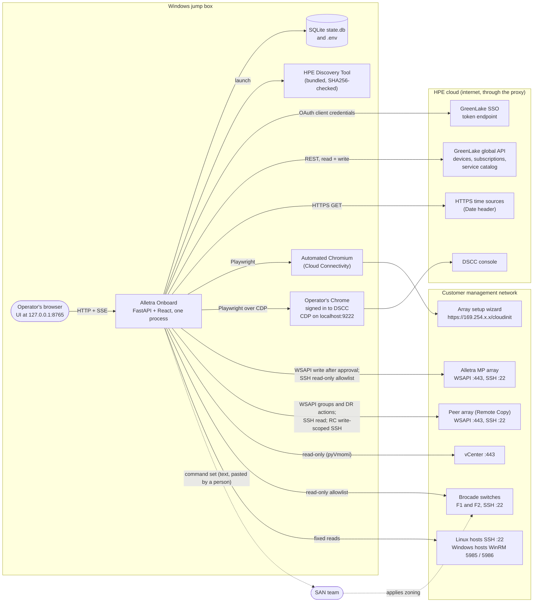
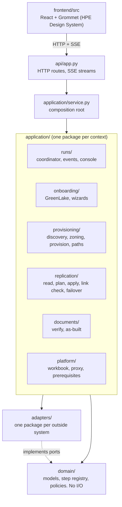

# High-Level Design: Alletra Onboard

| | |
|---|---|
| Item | BL-22 |
| Software | `alletra_onboard` v0.18.0 (`pyproject.toml`) |
| Checked against | `main` at b7006373, 2026-11-16 |
| Audience | HPE architects and tenet reviewers (BL-30) who will not read the code |
| Companion | The Low-Level Design, [LLD.md](LLD.md), is written on a separate branch (BL-23). It covers module contracts, data models and the API one route at a time. |

This document says what the tool is, where it runs, what it talks to, how it keeps a customer
array safe, and what has run on real hardware. Each claim links to its source. Where this document
and the code disagree, the code is right; please report the gap.

Status words follow [SCOPE.md](../SCOPE.md): **live-verified** means the tool did the work on lab
hardware through the application. **Built, pending live run** means the code and its tests exist
(tests use captured device output), but nobody has yet run it on hardware.

---

## 1. Purpose and scope

### 1.1 What the tool does

Alletra Onboard deploys one **HPE Alletra Storage MP B10000** block array for an HPE field
engineer. In one guided web application it:

1. registers the array in **HPE GreenLake** and assigns it to Data Services with a subscription;
2. connects the array to GreenLake with the array's own Cloud Connectivity wizard;
3. fills the **DSCC** (Data Services Cloud Console) *Set Up System* wizard;
4. discovers the array, the ESXi hosts (through vCenter), Windows and Linux hosts, and both SAN fabrics;
5. checks SAN zoning and writes the Brocade zoning **command set** for the SAN team to apply;
6. creates hosts, volumes, sets and exports on the array, after the engineer approves a plan;
7. sets up Remote Copy replication to a peer array and runs a failover test;
8. verifies the array's settings against the workbook;
9. writes the **as-built** Word document for hand-over.

The source of truth for scope and status is [SCOPE.md](../SCOPE.md). It splits the work into nine
areas. This tool covers area 1 (initialization), most of areas 2 to 5 for block storage, and the
block half of areas 8 and 9 (reports and documents).

### 1.2 Design principles

These come from [SCOPE.md](../SCOPE.md) *Principles*, [AGENTS.md](../../../../AGENTS.md) *Hard
rules* and the ADRs in [docs/adr/](../adr/).

- **Discovery-driven.** The workbook carries the customer's intent and the addresses and
  credentials to reach things. Every fact about the environment is read at run time
  ([ADR 0002](../adr/0002-provisioning-driven-by-discovery.md)).
- **Read first. Write only after an approved plan.** Every write to an array follows a plan the
  engineer has read and ticked. Discovery, verification and the as-built never change anything.
- **No switch writes.** Zoning is a copy-paste command set
  ([ADR 0012](../adr/0012-no-switch-writes-the-tool-emits-a-command-set.md)).
- **One array per run.** A workbook that names two arrays is refused
  ([init_sheet.py `_reject_two_arrays`](../../src/alletra_onboard/application/platform/init_sheet.py)).
- **Undo is a document.** Every write step produces the exact commands that remove what it
  created. The tool never runs them itself ([SPEC-007](../specs/SPEC-007-removal-set.md)).
- **Validate live.** A feature is done when it has run on lab hardware
  ([LESSONS.md](../LESSONS.md)).

### 1.3 Out of scope (non-goals)

| Not done | Why, and where it is recorded |
|---|---|
| Writing to a SAN switch (create, change or activate zoning) | Applying zoning is the SAN team's job, on their schedule. A write path shipped in v0.14 and v0.15 and was removed in v0.16. [ADR 0012](../adr/0012-no-switch-writes-the-tool-emits-a-command-set.md) |
| Cisco MDS fabrics | Brocade FOS only. No MDS to test against. [ADR 0004](../adr/0004-auto-remediate-san-zoning.md) |
| Two arrays from one workbook (paired runs) | Deferred. The peer array is a credential on the Replication tab. [ADR 0014](../adr/0014-paired-runs-from-one-workbook.md) |
| Peer Persistence, Active Sync, 3DC replication; RCFC; VLANs on RCIP ports | Refused by the sheet check (listed at upload, refused for a run that uses the tab) or not planned. [SPEC-015](../specs/SPEC-015-replication-tab.md), [SPEC-021](../specs/SPEC-021-rcip-partnership.md) §3 |
| ESXi datastore creation and the host-side rescan | The engineer rescans; the tool reports what the host sees. [ADR 0010](../adr/0010-provisioning-builder-consumes-zoning.md), [SPEC-013](../specs/SPEC-013-esxi-paths.md) R4 |
| Signing in to DSCC, handling DSCC passwords or MFA | The engineer signs in by hand; the tool attaches to that browser. [dscc_setup.py](../../src/alletra_onboard/adapters/browser/dscc_setup.py) |
| A general shell to the array | The console runs the read-only allowlist only. [SPEC-019](../specs/SPEC-019-console.md) §3 |
| Day-2 administration of the customer's array | The user is the deployment engineer, not the customer's admin. [SCOPE.md](../SCOPE.md) *Objective* |
| Snapshots, file storage (Unified File, GreenLake for File), performance reporting, VLAN and migration | Not started. Tracked as BL-21, BL-28, BL-29, BL-24, BL-25 to BL-27 in [TRACKER.md](../TRACKER.md). |

---

## 2. Users and where it runs

### 2.1 Users

| Who | What they do with the tool |
|---|---|
| HPE deployment, field or PS engineer (the operator) | Fills or receives the workbook, runs the steps, approves each plan, hands over the as-built. |
| SAN team at the customer | Receives the zoning command set and applies it. Never uses the tool. |
| Customer | Fills the workbook (intent, addresses, credentials). Receives the as-built document. |

### 2.2 Where it runs

The tool runs on a **Windows jump box** next to the array, on the customer's management network
([README.md](../../README.md), *Where it runs*). The jump box must be on the array's link-local
subnet for the Cloud Connectivity step, and must reach the internet (directly or through a proxy)
for GreenLake and DSCC.

- One process. A FastAPI backend serves the React UI and the API on **`http://127.0.0.1:8765`**
  ([config.py](../../src/alletra_onboard/config.py)), loopback only, with live progress over
  Server-Sent Events. The API has no login of its own; the operator's Windows session is the boundary.
- Blocking device calls (SSH, WSAPI, vCenter) run on worker threads under `asyncio.to_thread`.
- State lives in a local SQLite file, `.alletra_onboard/state.db`. In the packaged `.exe` it sits
  next to the executable ([packaging/app_main.py](../../packaging/app_main.py)).
- Run it as Administrator so the *Sync system clock* button can set the clock
  ([README.md](../../README.md), *Clock skew & DSCC sign-in*).

### 2.3 How it is delivered

| Build | Contents | Who it is for |
|---|---|---|
| `alletra-onboard-win64.zip` (slim `.exe`) | The app, the built UI, the HPE Discovery Tool. Drives the installed Chrome or Edge; downloads Chromium only if neither exists. | Operators, default choice |
| `alletra-onboard-offline-win64.zip` (`.exe`) | As slim, with Chromium bundled | Locked-down boxes with no Chrome or Edge and no route to the browser download site |
| `alletra-mp-initialization-win64.zip` (`.exe`, `init-only` profile) | Onboarding steps only, an onboarding-only workbook, the mode chooser locked to Initialization | Engineers who only initialise arrays ([ADR 0007](../adr/0007-init-only-build-profile.md)) |
| `alletra-onboard-latest.zip` (source zip) | `src/`, the built UI, `start.cmd` / `start.ps1`, which create a Python environment on first run | Operators who prefer a Python install |

Sources: [README.md](../../README.md), [build_exe.ps1](../../scripts/build_exe.ps1). The `.exe`
bakes its profile (`full` or `init-only`) into the build; the app reads it at start as
`ALLETRA_PROFILE` ([alletra_onboard.spec](../../alletra_onboard.spec), [app_main.py](../../packaging/app_main.py)).

---

## 3. System context

Every outside system the tool talks to, with the direction and the transport. Arrows point from
the side that starts the connection.



| Outside system | What the tool does there | Read or write | Code |
|---|---|---|---|
| GreenLake SSO and global API | Token, then register the device, assign application and region, apply the subscription, verify | Write (GreenLake records only) | [adapters/greenlake/](../../src/alletra_onboard/adapters/greenlake/) |
| Array setup wizard (link-local) | Fills Network, Proxy and Time, checks the Review page, submits | Write (the array's network setup) | [cloudinit_wizard.py](../../src/alletra_onboard/adapters/browser/cloudinit_wizard.py) |
| DSCC console, in the operator's signed-in Chrome | Fills *Set Up System* and stops at *Review and Finalize*. The operator enters the credential and submits | Fills forms; never submits | [dscc_setup.py](../../src/alletra_onboard/adapters/browser/dscc_setup.py) |
| Array WSAPI (HTTPS 443) | Structured reads; creates hosts, volumes, sets, exports; Remote Copy groups and DR actions | Write, only after an approved plan | [wsapi_client.py](../../src/alletra_onboard/adapters/array/wsapi_client.py) |
| Array SSH (22) | Read-only `show*` and `checkhealth` commands; link test diagnostics | Read | [cli_client.py](../../src/alletra_onboard/adapters/array/cli_client.py) |
| Array SSH, write-scoped (22) | RCIP addresses, `startrcopy`, Remote Copy targets and links | Write, only inside an approved replication plan | [rc_cli_client.py](../../src/alletra_onboard/adapters/array/rc_cli_client.py) |
| vCenter (443) | ESXi host HBAs, WWPNs, IQNs, OS, serial; ESXi path view | Read | [vcenter_client.py](../../src/alletra_onboard/adapters/vcenter/vcenter_client.py) |
| Brocade FOS switches (SSH 22) | Name server, aliases, zones, active configuration | Read | [brocade_client.py](../../src/alletra_onboard/adapters/fabric/brocade_client.py) |
| Linux hosts (SSH 22) | Hostname, OS, serial, FC WWPN, IQN, multipath summary | Read | [linux_ssh.py](../../src/alletra_onboard/adapters/hosts/linux_ssh.py) |
| Windows hosts (WinRM) | Hostname, OS, serial, initiator ports, MPIO | Read | [windows_winrm.py](../../src/alletra_onboard/adapters/hosts/windows_winrm.py) |
| HTTPS time sources | Reads the `Date` header to correct jump box clock drift (DSCC sign-in fails on skew) | Read | [clock.py](../../src/alletra_onboard/adapters/system/clock.py) |
| Corporate proxy | Auto-detected per destination like the browser, with a manual override; on-site device addresses bypass it | n/a | [proxy.py](../../src/alletra_onboard/application/platform/proxy.py), [ADR 0008](../adr/0008-proxy-auto-detect-with-override.md) |

The firewall list the operator can download from the Prerequisites page is in
[prereqs.py](../../src/alletra_onboard/application/platform/prereqs.py) (all outbound TCP 443).

---

## 4. Architecture

### 4.1 Layers

The backend uses ports and adapters. Dependencies point inward
([ADR 0011](../adr/0011-bounded-context-refactor-decoupled-ux.md), [STANDARD.md](../STANDARD.md) §3.2).



| Layer | Holds | Key files |
|---|---|---|
| `domain/` | Models, the step registry, rate-limit and redaction policies, the persistence port | [workflow.py](../../src/alletra_onboard/domain/workflow.py), [models.py](../../src/alletra_onboard/domain/models.py), [policies.py](../../src/alletra_onboard/domain/policies.py), [ports.py](../../src/alletra_onboard/domain/ports.py) |
| `application/` | One package per context; `service.py` wires them | [service.py](../../src/alletra_onboard/application/service.py), [runs/coordinator.py](../../src/alletra_onboard/application/runs/coordinator.py) |
| `adapters/` | Device, cloud, browser and storage I/O; the command log | [adapters/](../../src/alletra_onboard/adapters/), [command_log.py](../../src/alletra_onboard/adapters/command_log.py) |
| `api/`, `cli/` | Routes and schemas; the `onboard ui`, `api` and `check` commands | [app.py](../../src/alletra_onboard/api/app.py), [schemas.py](../../src/alletra_onboard/api/schemas.py), [cli/main.py](../../src/alletra_onboard/cli/main.py) |
| `frontend/src/` | One component per step in `steps/`; the shared shell and console pane in `ui/` | [frontend/src/](../../frontend/src/) |

Main libraries ([pyproject.toml](../../pyproject.toml)): FastAPI, httpx, Playwright, openpyxl,
python-docx, paramiko (pinned below 4 so old FOS switches still connect), python-3parclient,
pyVmomi, pywinrm. Python 3.12.

### 4.2 How a step runs

1. The UI calls `POST /runs/{id}/<step>`. A missing precondition returns HTTP 409 with a sentence.
2. The coordinator starts a background task, one per run at a time
   ([coordinator.py](../../src/alletra_onboard/application/runs/coordinator.py) `spawn`).
3. The task's events are stored and pushed over SSE (`GET /runs/{id}/stream`); the UI draws the
   step from them. Its device commands go to the console stream (`GET /runs/{id}/console/stream`).

---

## 5. Modes and steps

### 5.1 The step registry

The steps and the modes are defined once, in
[domain/workflow.py](../../src/alletra_onboard/domain/workflow.py) (`STEP_REGISTRY` and
`_MODE_STEPS`). The backend serves them at `GET /app/profile`, and the UI draws its step list from
that answer ([api/app.py](../../src/alletra_onboard/api/app.py) `app_profile`,
[frontend/src/modes.ts](../../frontend/src/modes.ts)). No other place may hold a step list
([AGENTS.md](../../../../AGENTS.md) hard rule 5). The table below is a reading of that file on the
date of this document.

| Key | Label | Kind | What it does |
|---|---|---|---|
| `greenlake` | GreenLake registration | init | Register, assign, subscribe over the GreenLake API |
| `cloudinit` | Cloud Connectivity | init | Fill and submit the array's on-box setup wizard |
| `dscc` | DSCC Setup | init | Fill the DSCC *Set Up System* wizard; the operator submits |
| `discover` | Discovery | provision | Read the array, vCenter, hosts and fabrics |
| `zoning` | SAN Zoning | provision | Check zoning; build the Brocade command set |
| `provision` | Provision storage | provision | Plan, approve, create hosts, volumes, sets, exports; verify paths |
| `replicate` | Replication | replicate | Partnership (optional), link check, Remote Copy groups |
| `failover_test` | Failover test | replicate | Fail over and back on a test group |
| `verify` | Verify configuration | verify | Compare the array's settings with the workbook; status check |
| `asbuilt` | As-built document | verify | Write the Word document |

Init steps advance on their own from one to the next. The other steps start when the operator
clicks ([workflow.py](../../src/alletra_onboard/domain/workflow.py) `next_enabled_phase`). The two
replication steps exist only when the workbook has a Replication tab (`REPLICATION_STEP_KEYS`).

### 5.2 Modes

The operator picks a mode after uploading the workbook
([ADR 0005](../adr/0005-decouple-onboarding-into-modes.md)). The workbook is the same in every mode;
the mode only selects which steps run.

| Mode | Steps |
|---|---|
| Full onboarding | greenlake, cloudinit, dscc, verify, asbuilt |
| Provision only | discover, zoning, provision, verify, asbuilt |
| Both | greenlake, cloudinit, dscc, discover, zoning, provision, verify, asbuilt |
| Provision, then replicate | discover, zoning, provision, replicate, failover_test, verify, asbuilt |
| Verify only | verify, asbuilt |
| Custom | any selection, in registry order |

The `init-only` build shows only the Initialization mode ([ADR 0007](../adr/0007-init-only-build-profile.md)).

### 5.3 The workbook

One workbook describes one array
([init_sheet.py](../../src/alletra_onboard/application/platform/init_sheet.py)). Tabs:
*Initialisation* (identity, network, GreenLake client, DSCC set-up), *Provisioning* (array, vCenter
and switch addresses and credentials, defaults), *Volumes*, *Host sets*, *Hosts*, *Replication*
(optional: peer array and what to protect), *Replication network* (optional: RCIP ports to set up)
and *Prerequisites*. The upload checks the whole workbook before any run exists, then holds it on
the server under a single-use token. Only a problem on the Initialisation tab, or two arrays, refuses
the upload; a problem in another tab is listed on the sheet page and refuses only a run whose steps
use that tab (owner, 2026-11-19). Device passwords never go back to the browser. Choosing a mode
creates the run from that token ([ADR 0005](../adr/0005-decouple-onboarding-into-modes.md), revision
of 2026-07-01).

---

## 6. Main flows

### 6.1 Onboarding: GreenLake, Cloud Connectivity, DSCC

```mermaid
sequenceDiagram
    participant O as Operator
    participant T as Tool
    participant G as GreenLake API
    participant W as Array setup wizard
    participant D as DSCC (operator's Chrome)
    O->>T: Run GreenLake registration
    T->>G: token, find service manager in region, add device
    T->>G: PATCH assign application + region
    T->>G: PATCH apply subscription
    G-->>T: 202 + Location, polled to a final state
    O->>T: paste wizard link from the Discovery Tool, Fill & connect
    T->>W: fill Network, Proxy, Time; check Review; Submit
    W-->>T: array connected
    O->>D: sign in, open Set Up System
    O->>T: Run DSCC automation
    T->>D: fill Welcome to System, stop at Review
    O->>D: add the array credential, Submit
    O->>T: mark complete
```

- **GreenLake** ([greenlake_provision.py](../../src/alletra_onboard/application/onboarding/greenlake_provision.py)).
  Every write is guarded by a read first, so a rerun does not duplicate work. Assignment is two
  PATCH calls: application and region first, then subscription. GreenLake rejects one call with
  both. Writes answer 202 with a `Location`, which the tool polls until `SUCCEEDED`, `FAILED` or
  `TIMEDOUT` ([http_client.py](../../src/alletra_onboard/adapters/greenlake/http_client.py)).
  Each endpoint family has its own token bucket for rate limits
  ([policies.py](../../src/alletra_onboard/domain/policies.py) `TokenBucket`). A dry run makes only
  the reads and reports what it would write. The offline API reference is at
  [reference/greenlake_api_docs/greenlake/](../../../../reference/greenlake_api_docs/greenlake/services.md).
- **Cloud Connectivity** ([cloudinit_wizard.py](../../src/alletra_onboard/adapters/browser/cloudinit_wizard.py)).
  The link must be link-local: `https://169.254.x.x` or a bracketed `fe80::` address
  ([domain/cloudinit_url.py](../../src/alletra_onboard/domain/cloudinit_url.py)). Before it
  submits, the tool reads the Review page back. If the network values there do not match the
  workbook, it refills once and then refuses to submit, so a wrong address is never applied. A
  `fail-prov-*` error from the wizard means a GreenLake device or subscription problem. The fix is
  in GreenLake, not a retry.
- **DSCC** ([dscc_setup.py](../../src/alletra_onboard/adapters/browser/dscc_setup.py)). The tool
  attaches over the Chrome DevTools Protocol to a browser the operator signed in to
  (`localhost:9222`, [config.py](../../src/alletra_onboard/config.py) `browser_cdp_url`). It fills
  the wizard and stops before *Submit*. It never sees the GreenLake password or MFA.

### 6.2 Discovery

[application/provisioning/discovery.py](../../src/alletra_onboard/application/provisioning/discovery.py)
reads, all read-only:

- the array, in one SSH session: FC and iSCSI target ports (`showport`, `showport -iscsi`) and
  the array's host view (`showhost -d`), including logins no host has claimed yet;
- each port's fabric, from the switch the port is attached to (`showportdev fcfabric`, once per
  fabric), with port-number parity as a fallback that is always reported
  ([ADR 0009](../adr/0009-fabric-from-switch-with-parity-fallback.md));
- ESXi hosts from vCenter: HBA WWPNs, IQN, OS, serial;
- hosts listed in the workbook without typed identifiers, matched by name and address, then read
  from the server: Windows over WinRM, Linux over SSH ([SPEC-014](../specs/SPEC-014-agentless-hosts.md)).

If one source fails, discovery records a note and continues. The result is stored as a run artifact
with its time. Later steps show its age and warn after twelve hours
([LESSONS.md](../LESSONS.md) lesson 8).

### 6.3 SAN zoning: the command set

[zoning.py](../../src/alletra_onboard/application/provisioning/zoning.py) checks, per host, whether
each HBA is logged in on both fabrics. [zoning_plan.py](../../src/alletra_onboard/application/provisioning/zoning_plan.py)
reads both switches (`nsshow`, `nscamshow`, `alishow`, `cfgshow`) and offers, per fabric, single-initiator
single-target pairs. Nothing is pre-ticked: the operator ticks each pair and names the aliases.
The tool then renders `alicreate`, `zonecreate` and `cfgadd` lines in FOS order, with `cfgsave` and
`cfgenable` shown apart because activation is a scheduled SAN-team act
([SPEC-010](../specs/SPEC-010-zoning-fos-order.md),
[ADR 0012](../adr/0012-no-switch-writes-the-tool-emits-a-command-set.md)). Names that clash with
the switch, a new name used for two ports, and zone names over 64 characters are refused before the
command set is generated. The switch client has no write verb at all
([brocade_client.py](../../src/alletra_onboard/adapters/fabric/brocade_client.py) `ALLOWED_READ`).

### 6.4 Block provisioning

The engineer composes hosts, volumes, sets and exports in a builder over discovered objects
([ADR 0010](../adr/0010-provisioning-builder-consumes-zoning.md)). Then:

- **Plan** ([storage_provision.py](../../src/alletra_onboard/application/provisioning/storage_provision.py),
  [SPEC-001](../specs/SPEC-001-plan-truth.md)). Each row has a state and a reason. An object that
  exists but differs is a conflict, and a conflict blocks the apply.
- **Zoning gates the export, not the run.** Hosts are created anyway, as HPE documents register
  first. An export to a host the array cannot reach (not logged in on its fabrics) is held back and
  named in the plan. An iSCSI host whose IQN is logged in needs no zoning
  ([ADR 0012](../adr/0012-no-switch-writes-the-tool-emits-a-command-set.md), revision of 2026-09-02).
- **Apply** writes over WSAPI in a fixed order: hosts, host sets, volumes, volume sets, exports.
  Each create is idempotent. Exports are judged against the array's VLUN templates before sending,
  then read back. Before any write, the WSAPI login works as a readiness gate: a degraded array
  answers 503 and the tool stops with a sentence
  ([ADR 0003](../adr/0003-transport-wsapi-with-readiness-gate.md)).
- **Removal set** ([SPEC-007](../specs/SPEC-007-removal-set.md)): the `remove*` commands for exactly
  what this apply created, in dependency order. Objects that existed before are never in it.
- **Path verification** ([path_verify.py](../../src/alletra_onboard/application/provisioning/path_verify.py)):
  read `showvlun -a` and report per host whether paths are live on both fabrics (FC) or both
  controller nodes (iSCSI). The ESXi view reads what each host sees through vCenter
  ([SPEC-013](../specs/SPEC-013-esxi-paths.md)).

### 6.5 Replication (Remote Copy)

Replication runs from this run's array to one peer array named on the Replication tab
([SPEC-015](../specs/SPEC-015-replication-tab.md)). Code:
[application/replication/](../../src/alletra_onboard/application/replication/).

1. **Read both arrays** over the read-only SSH client: system, ports, RCIP ports, Remote Copy
   targets, links and groups ([read.py](../../src/alletra_onboard/application/replication/read.py)).
2. **Partnership, when the Replication network tab is filled** ([SPEC-021](../specs/SPEC-021-rcip-partnership.md),
   [partnership.py](../../src/alletra_onboard/application/replication/partnership.py)). Plan per
   array: RCIP address per port, start Remote Copy, a target pointing at the other array. A port
   with another address or another role is a conflict; the tool never changes a port's role or an
   existing address. On approval it sets the addresses, pings, starts Remote Copy, creates the
   targets and waits for the links to come up. This is one of the two SSH write paths (section 7.3).
3. **Link check** ([link_check.py](../../src/alletra_onboard/application/replication/link_check.py),
   [SPEC-020](../specs/SPEC-020-link-check.md)): `checkrclink` between the paired ports, or a ping
   when it prints no latency. On RCIP, the groups apply is refused until the link is checked in this
   run. A latency over the limit for sync needs the operator's *Continue anyway*.
4. **Groups** ([plan.py](../../src/alletra_onboard/application/replication/plan.py),
   [apply.py](../../src/alletra_onboard/application/replication/apply.py),
   [SPEC-016](../specs/SPEC-016-replication-step.md)): plan, approve, then over WSAPI create the
   group, set period and policies, admit each volume, create the peer volume set, start. The apply
   stops at the first failure. The removal set covers what was created, as an A block and a B block.
5. **Verify** ([verify.py](../../src/alletra_onboard/application/replication/verify.py)): `showrcopy`
   on both arrays, reported as *Replicating*, *Initial sync in progress* or *Not replicating*, with
   HPE's next step.
6. **Failover test** ([failover.py](../../src/alletra_onboard/application/replication/failover.py),
   [SPEC-017](../specs/SPEC-017-failover-test.md)): HPE's planned-DR sequence over WSAPI actions on
   the tool's own test group, with its own approval. A group the run did not create needs its name
   typed back. The test ends in the starting state, or says which step failed and the one action
   that restores it.

Existing groups, targets and links the run did not create are listed and left alone (SPEC-016 R9).

### 6.6 Verify configuration

[documents/verification.py](../../src/alletra_onboard/application/documents/verification.py) logs in
over the read-only SSH client and compares `showsys -d`, `shownet` and `showdate` with the workbook,
field by field: pass, mismatch, or not readable. It adds the `checkhealth -svc -detail` issue table
and the inventory. It is a confidence check and never fails the run
([ADR 0001](../adr/0001-post-init-verification-via-ssh-cli.md)).

### 6.7 As-built document

[documents/asbuilt.py](../../src/alletra_onboard/application/documents/asbuilt.py) reads the array
read-only (`show*`, `checkhealth`, `showinventory`), parses CSV output where the array offers it, and
fills the HPE Block Storage Word template shipped in
[resources/asbuilt_template.docx](../../src/alletra_onboard/resources/asbuilt_template.docx).
Template headings are matched by intent, not exact text. The document is always produced; anything
that did not fill is listed as a warning ([CONTEXT.md](../../CONTEXT.md) *As-built warning*).
Sections cover identity, hardware, capacity, network and status; the provisioned objects, zoning and
removal set ([SPEC-002](../specs/SPEC-002-asbuilt-provisioned.md)); replication and the failover test
read back from both arrays ([SPEC-018](../specs/SPEC-018-replication-asbuilt.md)); and an appendix
listing every change the tool made, with reads counted
([SPEC-019](../specs/SPEC-019-console.md) §6). The document is stored with the run and downloaded
from `GET /runs/{id}/asbuilt/download`.

### 6.8 Console

[SPEC-019](../specs/SPEC-019-console.md). Every command the tool sends to an array, switch, vCenter,
host or GreenLake is recorded with its target, transport, duration, result and output (capped at 64 KB). The records go
to a table of their own and a live stream, and show in a pane under every step
([ConsolePane.tsx](../../frontend/src/ui/ConsolePane.tsx)). The operator can type a command in the
pane; it runs through the read-only allowlist with the run's credential, on this array or the peer.
Anything else is refused with a sentence pointing to *Open terminal*, which opens the system
terminal with `ssh user@array` and no password.

Recorded: array SSH (both clients), array WSAPI, switch SSH, and since BL-54 vCenter (one record per
login and per inventory read, as pyVmomi has no single call to hook), Linux host SSH, Windows host
WinRM and GreenLake HTTP calls. A GreenLake record is the method and path only: no query, no body,
no error text, as a subscription key travels in all three; the token request shows neither the client
secret nor the token.

---

## 7. Security model

### 7.1 Secrets

| Secret | Where it lives | Where it never goes |
|---|---|---|
| GreenLake client ID and secret | `.env` next to the app, written on workbook upload or the Configure page ([config.py](../../src/alletra_onboard/config.py)) | git; the browser after upload |
| Array, peer, vCenter, switch, host and migration source passwords; the subscription key; the DSCC system password | The uploaded workbook, then the run's record in the local `state.db` for the life of the run ([ADR 0013](../adr/0013-one-array-credential-per-run.md)), encrypted with the installation's key ([ADR 0027](../adr/0027-stored-credentials-encrypted-at-rest.md)) | Run events, artifacts, logs, the as-built, API responses. `SecretStr` masks them in model dumps |
| The key that encrypts them | `secrets.key` next to `state.db`, made on first use, 0600 on POSIX; on Windows in the user's own `%LOCALAPPDATA%\AlletraOnboard` | The database, git, logs, API answers, evidence and release zips |
| DSCC and GreenLake user passwords, MFA | The operator's own browser | The tool, entirely |
| Lab passwords (developers only) | The jump box `.env` (`LAB_ARRAY_PW`, `LAB_DEFAULT_PW`) | git; `check.py` scans added lines for them |

The secret fields of the state database are encrypted at rest (BL-65,
[ADR 0027](../adr/0027-stored-credentials-encrypted-at-rest.md)); the rest of each row stays readable
for support. This protects a copy of `state.db` on its own (a support case, another computer, an
evidence zip): its stored credentials cannot be read there, and the steps say so and ask for the sheet
again. It does not protect against someone who can read both files, such as anyone signed in with the
same Windows account. Rows saved before BL-65 stay in clear until their run is saved again; uploaded
sheets nobody turned into a run are purged after 24 hours. DPAPI, to bind the key file to the Windows
user, is left for when it can be tested on Windows.

### 7.2 Read-only by construction

Each read client can run only a fixed list, and refuses shell metacharacters (`; | & $ > <` and
backtick, newline) before anything is sent.

| Client | Guard |
|---|---|
| Array SSH ([cli_client.py](../../src/alletra_onboard/adapters/array/cli_client.py)) | `ALLOWED_COMMANDS`: `show*` commands plus `checkhealth`, checked on the first word |
| Array link test (same file) | `_DIAGNOSTIC_FORMS`: `checkrclink start/stop server/client` and `controlport rcip ping -c N`, each matched as a whole line with bounded values. Used only by the link check |
| Brocade switch ([brocade_client.py](../../src/alletra_onboard/adapters/fabric/brocade_client.py)) | `ALLOWED_READ`: `cfgshow`, `zoneshow`, `alishow`, `nsshow`, `nscamshow`, `nsallshow`, `fabricshow`, `switchshow`, `cfgtransshow`. No write verb exists in the client |
| Linux host ([linux_ssh.py](../../src/alletra_onboard/adapters/hosts/linux_ssh.py)) | A fixed dictionary of read commands addressed by key; `sudo -n` only for two root reads, never a prompt |
| Windows host ([windows_winrm.py](../../src/alletra_onboard/adapters/hosts/windows_winrm.py)) | A fixed dictionary of PowerShell reads addressed by key |
| vCenter ([vcenter_client.py](../../src/alletra_onboard/adapters/vcenter/vcenter_client.py)) | Inventory reads only |

Adding a command to any list needs a unit test and a plain sentence in the pull request
([.github/instructions/adapters.instructions.md](../../../../.github/instructions/adapters.instructions.md)).

### 7.3 The write paths

Four kinds of path change something outside the jump box. Each has a gate.

| Write path | What it may change | Gate |
|---|---|---|
| GreenLake API | The device's GreenLake record (register, assign, subscribe) | The operator runs the step; reads first, so reruns are safe |
| Browser wizards | Array network setup through its own wizard (submitted after a Review read-back); DSCC form fields (never submitted) | Operator reviews values in the app; the Review guard; the operator submits DSCC |
| Array WSAPI | Hosts, sets, volumes, exports; Remote Copy groups and DR actions | A plan previewed in this process, with no conflicts, then the operator's tick and button |
| Array SSH, write-scoped ([rc_cli_client.py](../../src/alletra_onboard/adapters/array/rc_cli_client.py), [ADR 0015](../adr/0015-tool-configures-remote-copy-write-scoped-ssh.md)) | RCIP address, gateway and ping; `startrcopy`; create and remove Remote Copy targets; admit and dismiss links | Built only inside the apply of an approved replication plan; every command matched against `RC_WRITE_FORMS` as a whole line, addresses and masks validated |
| Array SSH, write-scoped ([snap_cli_client.py](../../src/alletra_onboard/adapters/array/snap_cli_client.py), [ADR 0016](../adr/0016-snapshot-schedules-write-scoped-ssh.md)) | Create a snapshot schedule: one form, `createsched -f` of a `createsv -f` with an expiry and no lock (built 2026-11-17, pending live run) | Built only inside the apply of an approved snapshot plan, with that plan's (schedule name, source) pairs; the command inside the quotes checked as a form of its own; `removesched -f` in the removal set before the write; `showsched` read back after it |

How the approval is held, from the code:

- The previewed plan lives **in memory** with the exact discovery it was built from
  ([provisioning/steps.py](../../src/alletra_onboard/application/provisioning/steps.py) `_plan`).
  A new discovery, a change to the composition, or a restart withdraws it. An apply without a
  current plan, or with a conflict, is refused with HTTP 409. The replication plan follows the
  same rule and is spent by one apply ([replication/steps.py](../../src/alletra_onboard/application/replication/steps.py)).
  Why: [LESSONS.md](../LESSONS.md) lesson 6, an approval must not outlive its inputs or its process.
- The tick-box is a UI control, and the server checks it too (BL-52, 2026-11-17): each previewed plan
  carries an id, and an apply must send the id of the plan the operator ticked. A missing id is refused
  ("Tick the approval for this plan first."), and so is an id from an earlier plan ("The plan changed
  since it was approved."). A new preview or a re-run of discovery withdraws the held plan.
- The write-scoped SSH client is a separate class. The read client stays the default for every
  read, and the console can never reach the write client (SPEC-019 R3). The write forms cannot
  remove a group, stop Remote Copy, change a port's role or touch a non-RCIP port
  ([rc_cli_client.py](../../src/alletra_onboard/adapters/array/rc_cli_client.py) docstring).
- There is no switch write path. The zoning deliverable is text for the SAN team.

### 7.4 Redaction and the command log

- GreenLake logging passes through `redact()`, which masks bearer tokens, `client_secret` and
  subscription keys ([policies.py](../../src/alletra_onboard/domain/policies.py)).
- Every command record replaces every secret the client holds with `********` before the record
  leaves the client, then passes through `redact()` as well. The WSAPI login body shows the password masked and its answer as
  *(session key withheld)* ([command_log.py](../../src/alletra_onboard/adapters/command_log.py),
  [SPEC-019](../specs/SPEC-019-console.md) §6). The live run of 2026-10-12 checked that no password,
  session key or write appeared in the log.
- The as-built appendix lists every change the tool made, so the customer document shows what
  touched the array.

### 7.5 Transport trust: certificates and host keys

The policy, decided by the owner on 2026-11-17 ([ADR 0026](../adr/0026-certificates-and-host-keys.md)),
built 2026-11-17 (BL-53), pending a live run:

Cloud endpoints (GreenLake, DSCC) always have their TLS certificates checked against the Windows and
public roots; this cannot be switched off. On-site devices ship with self-signed certificates, so the
tool trusts each array, vCenter, switch and Linux host on first contact. It records the certificate
or SSH key fingerprint in the run, shows it to the operator and writes it into the as-built. Any
later change blocks the run until the operator deliberately re-trusts the device. A customer CA
bundle, where one exists, replaces first-contact trust. Two links stay unchecked, with written
reasons: the link-local setup wizard (same cable, no credentials) and WinRM (NTLM-encrypted,
read-only).

What the code does:

- **Cloud calls** verify TLS against the Windows trust store plus public roots. Verification is
  never turned off; a PEM bundle can be named for inspecting proxies (`ALLETRA_CA_BUNDLE`,
  [tls.py](../../src/alletra_onboard/adapters/tls.py)).
- **One place decides for on-site devices**:
  [device_trust.py](../../src/alletra_onboard/adapters/device_trust.py). The run coordinator binds
  the run's pins for every step and every route that reads a device, as it binds the command log.
  Before a client sends a password it hands over what the device presented: the key is recorded on
  the run's first contact, the same key goes through, and a different one is refused with a sentence
  naming the device and both fingerprints and saying the password was not sent. The pins live in
  the run's `run_device_pins` rows in `state.db` (section 8), so a new run trusts again on its own
  first contact.
- **SSH** (array reads, the link check, the console, the Remote Copy write client, Brocade, Linux
  hosts) connects through `open_ssh`: a paramiko `MissingHostKeyPolicy` records the key on first
  contact, and later connections preload the pinned key so paramiko compares it before it
  authenticates.
- **Array WSAPI** reads the certificate in a handshake that sends nothing, compares it, then logs in;
  every later connection of the SDK checks the same SHA-256 (urllib3's `assert_fingerprint`).
  **vCenter** is compared the same way first, then pyVmomi gets a context that compares the pinned
  certificate on every connection it opens.
- **A device CA bundle** (`ALLETRA_DEVICE_CA_BUNDLE`, separate from the cloud bundle) replaces
  first-contact trust for WSAPI, vCenter and WinRM over HTTPS with the full check (chain and name).
  A failure stops the step; it never falls back.
- **A mismatch blocks the step**: the step shows as stopped with the sentence, and the run overview
  shows both fingerprints. Re-trusting is a separate action there, behind a tick that the new
  fingerprint was compared with the device's own console, and is recorded as a run event with both
  fingerprints. There is no re-trust button next to the error.
- **Still unchecked, each with its reason at the code site** (`# TRUST-OFF:`, listed in
  `tests/unit/test_trust_checks_off.py`, which fails on a new site): the setup wizard's browser
  (`ignore_https_errors`; the address must be link-local) and WinRM with
  `server_cert_validation="ignore"` when no device CA bundle is set. WSAPI's `secure=False` and the
  context pyVmomi gets also turn the chain check off, each behind a pin.
- Pins last one run. Whether the array's certificate or key changes after initial setup (wizard, DSCC
  setup, a restart) is the open question of ADR 0026 step 9; until the live run, the re-trust action
  is the way past such a change.
- The local API on 127.0.0.1 has no authentication. Cross-origin requests are allowed only from the
  developer UI server on port 5173 ([app.py](../../src/alletra_onboard/api/app.py) CORS).

### 7.6 Repository hygiene

[check.py](../../scripts/check.py) is the pre-merge gate. It also refuses changes to `frontend/dist`
and scans added lines for tokens, private keys and lab passwords. Tests never call a live device
([tests.instructions.md](../../../../.github/instructions/tests.instructions.md)).

---

## 8. State and persistence

One SQLite file per installation ([adapters/persistence/sqlite.py](../../src/alletra_onboard/adapters/persistence/sqlite.py)):

| Table | Holds | Lifetime |
|---|---|---|
| `runs` | Run record: mode, selected steps, status, current phase | Kept |
| `run_events` | Every step event, in order (the run's timeline) | Kept |
| `work_items` | The array work item: identity, network, GreenLake and DSCC fields | Kept |
| `provisioning_intents` | Addresses, credentials, volumes, host sets, replication rows | Kept with the run |
| `pending_sheets` | A parsed workbook waiting for a mode, under a single-use token | Removed when the run is created, or after 24 hours |
| `run_artifacts` | Results: discovery report, hosts zoned on both fabrics, replication report and result, link check, failover record, as-built `.docx` | Newest 20 runs (`ARTIFACT_RETENTION_RUNS`) |
| `run_commands` | The console's command log | Newest 20 runs ([SPEC-019](../specs/SPEC-019-console.md) §6) |
| `run_device_pins` | The SSH key or certificate each on-site device presented on the run's first contact, and any different one it was refused for ([ADR 0026](../adr/0026-certificates-and-host-keys.md)) | Kept with the run |

The schema version is kept in `PRAGMA user_version`; a database from a newer version of the tool is
refused at start-up. Secrets in `work_items`, `provisioning_intents` and `pending_sheets` are encrypted
(section 7.1).

Deliberately **not** stored: a plan's approval (section 7.3) and running tasks. Run status values
are in [models.py](../../src/alletra_onboard/domain/models.py) `RunStatus`. A run reopened after a
restart resumes from its stored phase and artifacts; the operator previews again before any write.

---

## 9. Failure handling

| Situation | What the tool does | Source |
|---|---|---|
| A step's task crashes | The run moves to `retryable_failure` with a `step.crashed` event; it is never left `running` | [coordinator.py](../../src/alletra_onboard/application/runs/coordinator.py) `_guarded` |
| A step's precondition is missing | HTTP 409 with a sentence; nothing starts | [app.py](../../src/alletra_onboard/api/app.py) `_start_step` |
| Array WSAPI not ready (503) | Stop before any write, with the next thing to check | [ADR 0003](../adr/0003-transport-wsapi-with-readiness-gate.md) |
| Array not yet subscribed | Volume creation is refused by the array; this is a GreenLake state, not a network fault | [CONTEXT.md](../../CONTEXT.md) *Array subscription* |
| GreenLake 202 operation | Polled to a final state; a failed or timed-out operation is reported, not assumed | [http_client.py](../../src/alletra_onboard/adapters/greenlake/http_client.py) |
| Wizard `fail-prov-*` | Reported as a GreenLake device or subscription problem; fix in GreenLake | [AGENTS.md](../../../../AGENTS.md) *Domain facts* |
| One discovery source down | A note on the report; the rest continues. vCenter down degrades the ESXi view to *not read* | [discovery.py](../../src/alletra_onboard/application/provisioning/discovery.py), [SPEC-013](../specs/SPEC-013-esxi-paths.md) R6 |
| A plan has a conflict | Apply refused until it is fixed on the array | [SPEC-001](../specs/SPEC-001-plan-truth.md) R6 |
| A write fails mid-apply | Outcomes so far are recorded. Replication and partnership applies stop at the first refusal. See open question 1 for provisioning | [apply.py](../../src/alletra_onboard/application/replication/apply.py), [SPEC-021](../specs/SPEC-021-rcip-partnership.md) R4 |
| A failover step fails | The screen names the step, both arrays' state and the action that restores it | [SPEC-017](../specs/SPEC-017-failover-test.md) R5 |
| A workbook names two arrays | Refused at upload with both values | [init_sheet.py](../../src/alletra_onboard/application/platform/init_sheet.py) |

**The removal set.** Every write step produces text the operator can paste to undo exactly what it
created: provisioning ([SPEC-007](../specs/SPEC-007-removal-set.md)), Remote Copy groups
([SPEC-016](../specs/SPEC-016-replication-step.md) R7, A block then B block) and the partnership
([SPEC-021](../specs/SPEC-021-rcip-partnership.md) R5: targets, `stoprcopy` only where this run
started it, RCIP addresses). Rules: only objects with the status *created*; exports found by the
difference between before and after reads; dependency order; one command per object; never run by
the tool. The same block appears in the result, as a download, and in the as-built. Every
BL-41 lab run was returned to its starting state with its own removal set
([validation/2026-11-03-rcip-partnership.md](../validation/2026-11-03-rcip-partnership.md)).

---

## 10. Packaging and release

| Step | How | Source |
|---|---|---|
| Gate | `scripts/check.py` must say PASS. There is no CI on github.hpe.com | [README.md](../../README.md) *Day to day* |
| Merge | Squash-merge by the owner; `frontend/dist` is rebuilt from source after merge, never committed on a branch | [after_merge.sh](../../scripts/after_merge.sh) |
| Rolling zip | `publish_release.ps1` refreshes `alletra-onboard-latest.zip` in place | [publish_release.ps1](../../scripts/publish_release.ps1) |
| Tagged release | Version bump, tag, then on a Windows laptop on the HPE VPN: `publish_release.ps1 -Tag vX.Y.Z -BuildExe` builds the slim, offline and init-only `.exe` with PyInstaller, runs each one's `selftest` and a serve smoke test with a proxy set, and attaches the zips and SHA256 files | [README.md](../../README.md) *Releasing*, [build_exe.ps1](../../scripts/build_exe.ps1), [smoke_serve.ps1](../../scripts/smoke_serve.ps1) |
| Capabilities check | `GET /app/profile` reports whether the build bundled the WSAPI library, so a packaging fault shows without an array | [app.py](../../src/alletra_onboard/api/app.py) `app_profile` |

The `.exe` bundles the UI, the as-built template, the HPE Discovery Tool with its SHA256, and the
MSVC runtime Chromium needs. It is unsigned, so Windows SmartScreen warns on first launch
([README.md](../../README.md)). Lab scripts, tests and captures are not in any release.

---

## 11. What is live-verified and what is built

From [SCOPE.md](../SCOPE.md) (last checked v0.16.1 + main) and the *Closed* table in
[TRACKER.md](../TRACKER.md). Records are in [docs/validation/](../validation/).

| Area | Status | Evidence |
|---|---|---|
| 1. Initialization (GreenLake, Cloud Connectivity, DSCC, verify) | Live-verified | Run from scratch on a factory-fresh array, operator-confirmed 2026-09-29 |
| 2. Discovery: array, ESXi via vCenter, Windows over WinRM | Live-verified | rack13, 2026-09-28 |
| 2. Discovery: Linux over SSH | Live-verified, except the `multipath -ll` summary | 2026-10-05 and 2026-10-07; multipath is BL-36 |
| 3. FC zoning command set (Brocade) | Live-verified | A tool-designed zone, pasted as rendered, logged a host in, 2026-09-17; name checks live 2026-09-29 |
| 3. RCIP peer ports for replication | Live-verified | 2026-11-03 to 2026-11-06 (BL-41) |
| 4. Block provisioning, FC and iSCSI | Live-verified | Session runner 60/60 on 2026-09-19, 2026-09-28 and 2026-10-07 (packaged v0.16.1); iSCSI export 2026-10-05; iSCSI host creation 2026-10-26 |
| 4. Export to a host the tool created over iSCSI | Built, pending live run | Needs an array with iSCSI ports ([validation/2026-10-26-iscsi-host-create.md](../validation/2026-10-26-iscsi-host-create.md)) |
| 5. Replication groups, sync and periodic, through the UI | Live-verified | 2026-10-09 and 2026-10-10 |
| 5. Failover test, sync and async | Live-verified | 2026-10-10 and 2026-10-11 |
| 5. Partnership set up by the tool | Live-verified on Alletra MP to Primera | 25/0, 27/0, 35/0, 28/0, 2026-11-03 to 2026-11-06. Not shown: two Alletra MPs; steady routing between two networks |
| 5. Link check | See open question 3 | Exercised in the BL-41 runs; BL-42 still open |
| 8. Configuration check, inventory, `checkhealth` | Live-verified | Verify runs in every session-runner run ([SPEC-006](../specs/SPEC-006-session-runner.md)) |
| 9. As-built, initialization and provisioning sections | Live-verified | 2026-09-13; page review 2026-10-06 (BL-33) |
| 9. As-built replication sections | See open question 3 | |
| 9. HLD, LLD | This document; LLD on its own branch | BL-22, BL-23 |
| Console | Live-verified | labrat 2026-10-12, 22/0 (BL-39) |
| Not started | Snapshots (BL-21), performance reporting (BL-24), VLAN (BL-25), peer ports (BL-26), migration (BL-27), file storage (BL-28, BL-29) | [TRACKER.md](../TRACKER.md) |

---

## 12. Architecture decisions (index)

| ADR | Decision in one line |
|---|---|
| [0001](../adr/0001-post-init-verification-via-ssh-cli.md) | Post-init verification reads the array's running configuration over read-only SSH; amended by 0013 (credential) and 0015 (one write-scoped client). |
| [0002](../adr/0002-provisioning-driven-by-discovery.md) | The workbook carries intent and reach; every environment fact is discovered at run time. |
| [0003](../adr/0003-transport-wsapi-with-readiness-gate.md) | Provisioning goes over WSAPI behind a readiness check; SSH stays for reads WSAPI cannot do. |
| [0004](../adr/0004-auto-remediate-san-zoning.md) | The tool verifies zoning and produces a read-only zoning plan; Brocade FOS only. |
| [0005](../adr/0005-decouple-onboarding-into-modes.md) | The operator picks a mode after uploading one complete workbook; steps come from the registry. |
| [0006](../adr/0006-hybrid-control-plane.md) | Target architecture: DSCC cloud API primary, direct WSAPI for depth. Only the direct plane is built. |
| [0007](../adr/0007-init-only-build-profile.md) | The Initialization accelerator is a build profile of one codebase, not a fork. |
| [0008](../adr/0008-proxy-auto-detect-with-override.md) | Detect the system proxy like the browser, allow an override, bypass on-site devices. |
| [0009](../adr/0009-fabric-from-switch-with-parity-fallback.md) | A port's fabric comes from the switch it attaches to; port parity is a reported fallback. |
| [0010](../adr/0010-provisioning-builder-consumes-zoning.md) | Provisioning is an operator-composed builder in two tiers, create then verify paths; it consumes zoning. |
| [0011](../adr/0011-bounded-context-refactor-decoupled-ux.md) | Refactor into bounded contexts behind a frozen API; the step registry is served to the UI. |
| [0012](../adr/0012-no-switch-writes-the-tool-emits-a-command-set.md) | The tool never writes to a SAN switch; it emits the command set. Zoning gates the export per host. |
| [0013](../adr/0013-one-array-credential-per-run.md) | A run holds one array credential from the workbook, and every step uses it. |
| [0014](../adr/0014-paired-runs-from-one-workbook.md) | Two arrays from one workbook (paired runs): accepted, then deferred. |
| [0015](../adr/0015-tool-configures-remote-copy-write-scoped-ssh.md) | The tool configures Remote Copy: groups and DR over WSAPI, links and targets over a write-scoped SSH client. |
| [0025](../adr/0025-one-rule-for-ssh-writes.md) | One rule for every write over the array's SSH: exact command forms, only inside an approved apply, only on the plan's objects, an undo recorded before and a read-back after each write. Accepted 2026-11-17. |
| [0026](../adr/0026-certificates-and-host-keys.md) | Cloud certificates are always checked; on-site devices are trusted on first contact and pinned for the run; the setup wizard and WinRM stay unchecked with written reasons. Accepted 2026-11-17; built 2026-11-17, pending live run. |

Specifications: [docs/specs/](../specs/). Glossary: [CONTEXT.md](../../CONTEXT.md). Lessons: [LESSONS.md](../LESSONS.md).

---

## 13. Open questions for the owner

1. **Provisioning removal set after an exception.** In
   [storage_provision.py](../../src/alletra_onboard/application/provisioning/storage_provision.py)
   `apply_plan`, the removal set is computed at the end of the `with` block. If a WSAPI call raises
   part-way (for example a volume create the array refuses), `result.error` is set and the outcomes
   so far are kept, but the removal set appears to stay empty. No test in
   `tests/unit/test_removal_set.py` covers this path. Is that intended?
2. **Device trust and the approval tick.** *Device trust is answered.* On 2026-11-17 the owner
   accepted trust on first contact for on-site devices, kept certificate checks for GreenLake and
   DSCC, and kept two links unchecked with written reasons (section 7.5,
   [ADR 0026](../adr/0026-certificates-and-host-keys.md); built 2026-11-17, pending live run). *The approval tick is answered
   too:* the server checks the id of the ticked plan on every apply (section 7.3, BL-52).
3. **Status mismatches in the docs.** *Answered 2026-11-17:* SCOPE and ARCHITECTURE were brought in
   line with main and TRACKER (BL-47), and the link check (BL-42) was closed on the owner's decision,
   its over-the-limit path standing on unit tests until a pair over 10 ms exists.
