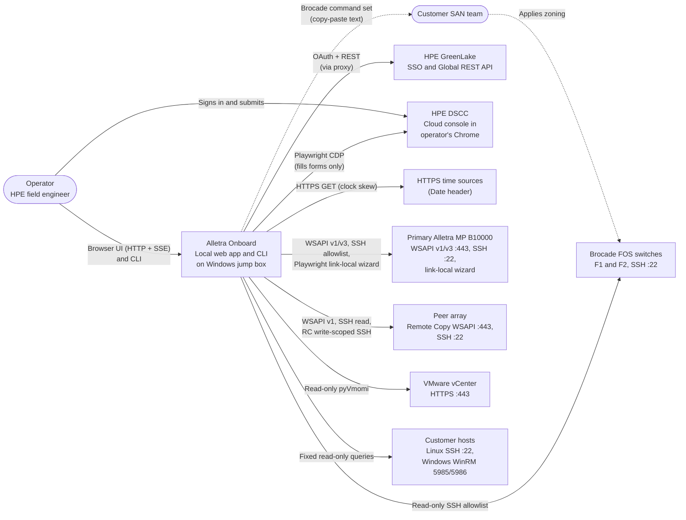
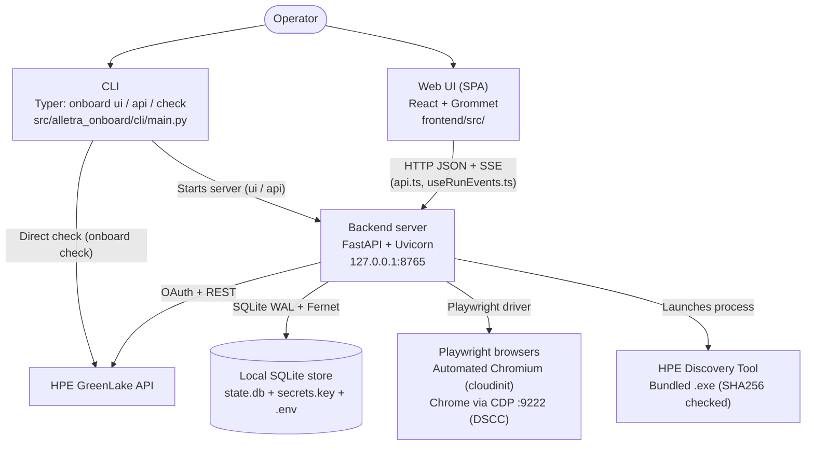
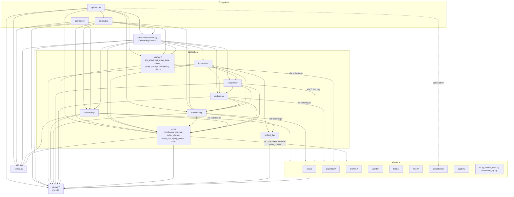
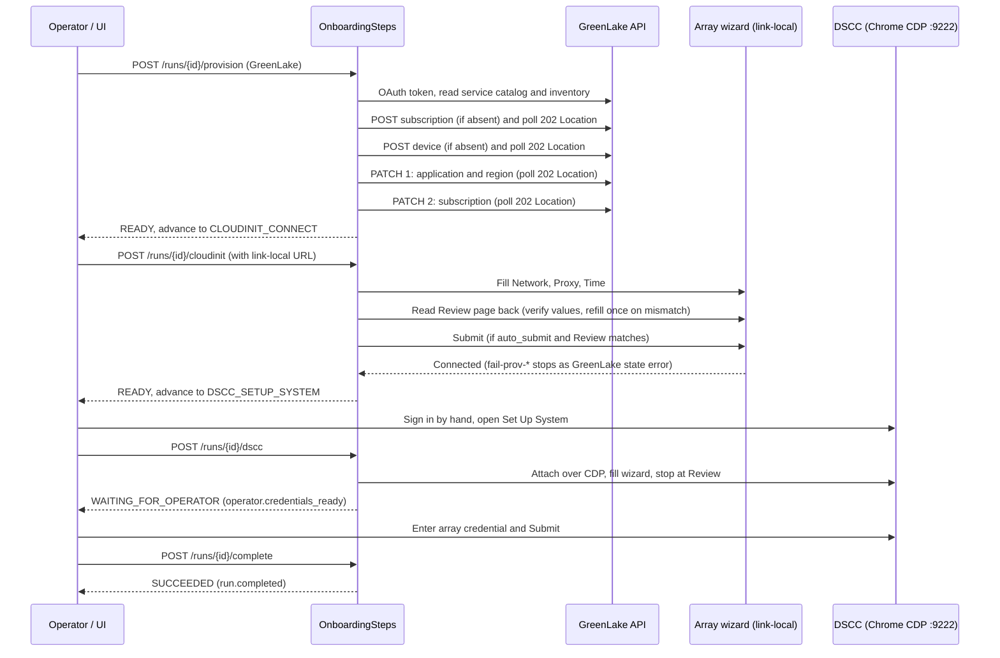
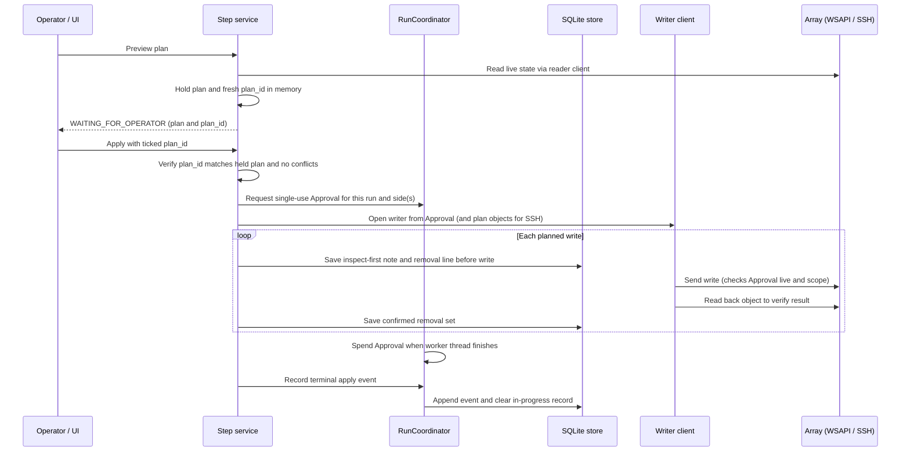
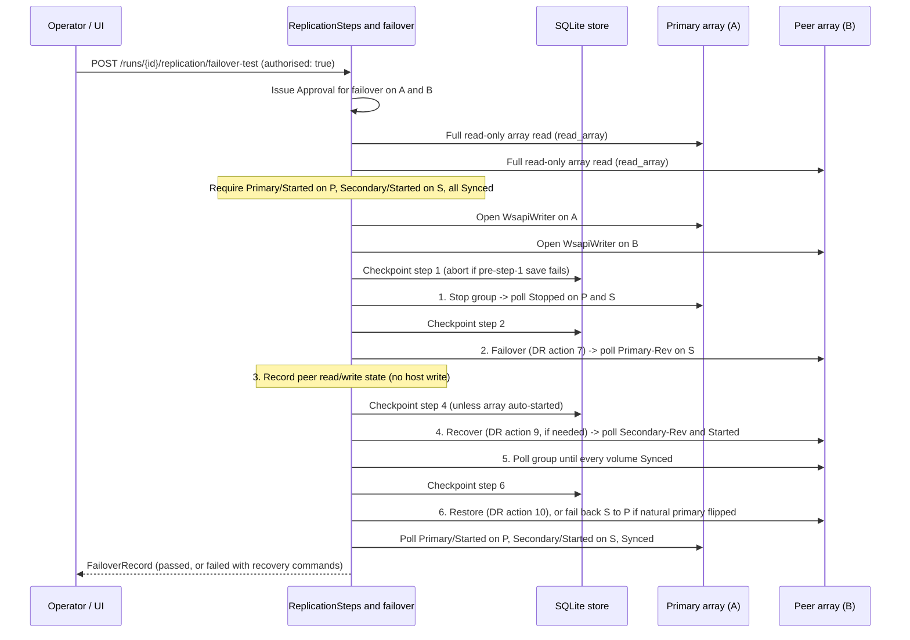
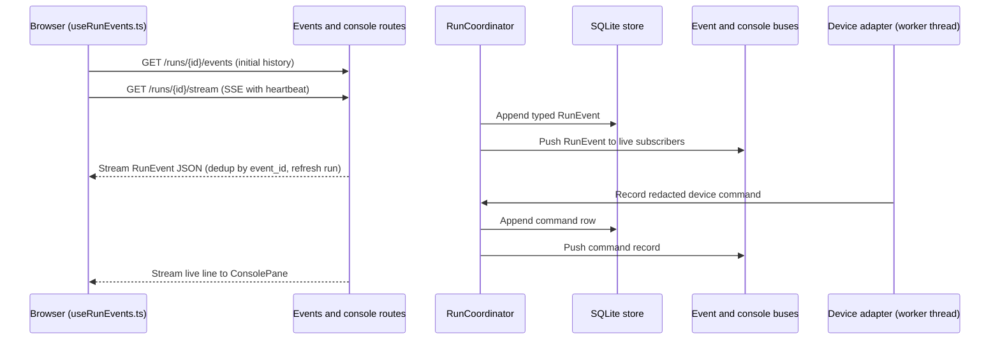
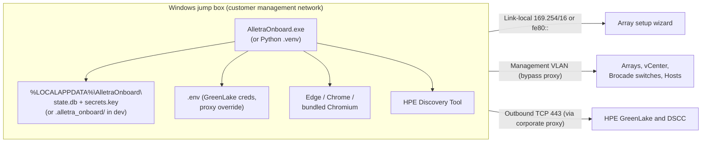

# High-Level Design: Alletra Onboard

Headings follow [arc42](https://arc42.org) and diagrams follow the [C4 model](https://c4model.com).
Companion document: [LLD.md](LLD.md). Where this document and the code disagree, the code is right.

---

## 1. Introduction and goals

Alletra Onboard is a local web app for HPE field engineers. It deploys one **HPE Alletra Storage MP
B10000** array per run from a single uploaded workbook:

1. registers the array in HPE GreenLake and assigns Data Services and a subscription;
2. connects the array to GreenLake through its link-local setup wizard;
3. fills the DSCC *Set Up System* wizard in the operator's signed-in browser;
4. discovers the array (block and Unified File), vCenter ESXi hosts, Windows/Linux hosts and Brocade
   SAN fabrics;
5. builds array-port command sets (iSCSI VLAN and migration peer ports) and Brocade SAN zoning
   command sets;
6. provisions block storage (hosts, host sets, volumes, volume sets, exports) and verifies paths;
7. creates snapshots and snapshot schedules;
8. sets up Remote Copy partnerships and groups, checks links and runs a planned failover test;
9. verifies the array against the workbook and writes the Word as-built document.

Feature scope and live-run status live in [docs/SCOPE.md](../SCOPE.md).

### Quality goals

Priority order — the higher goal wins when two conflict ([docs/STANDARD.md](../STANDARD.md) §1):

| # | Goal | Meaning |
|---|---|---|
| Q1 | Safe on customer equipment | Every outside write goes through its gate (section 4), SAN switches are never written to, and array applies keep an undo record. |
| Q2 | Truthful | Screens and documents report what devices answered. Failures and unknowns never render as empty or done. |
| Q3 | Operable on a jump box | One download, both build profiles (`full` and `init-only`), plain words on screen. |
| Q4 | Changeable without drift | Import contracts, type checks and fitness gates keep the structure intact. |

### Stakeholders

| Stakeholder | Role |
|---|---|
| HPE field engineer | Runs the app on a jump box, reviews each plan, approves array writes and delivers the as-built. |
| Customer SAN team | Applies the copy-paste Brocade zoning command set on their schedule. |
| Customer admin | Fills the workbook and receives the as-built document. |
| Maintainers and reviewers | Change the code under [docs/STANDARD.md](../STANDARD.md) and `scripts/check.py`. |

---

## 2. Constraints

All nine engineering and safety rules live in [AGENTS.md](../../../../AGENTS.md) (*Hard rules*) and
apply verbatim here. Operational constraints:

- Runs as one local process on a Windows jump box bound to `127.0.0.1:8765`, with no server
  infrastructure or app login.
- The jump box needs link-local access to the array, management-network access to on-site devices
  and outbound HTTPS (direct or via proxy) to HPE GreenLake and DSCC.
- The operator signs in to DSCC in their own Chrome; the app attaches over CDP on `localhost:9222`
  and never sees DSCC credentials or MFA.
- SAN zoning supports Brocade Fabric OS only ([ADR 0004](../adr/0004-auto-remediate-san-zoning.md)).
- Shipped `.ps1` scripts must stay pure ASCII for Windows PowerShell.

---

## 3. Context and scope

### C4 Level 1 — System context

### External interfaces

| External system | Transport | Access | Adapter |
|---|---|---|---|
| GreenLake SSO and Global API | HTTPS OAuth + REST (via proxy) | Read + write (subscription, device, assignment) | `adapters/greenlake/` |
| Array setup wizard | Playwright (`https://169.254.*` or `fe80::`) | Write (network, proxy, time; after Review check) | `adapters/browser/cloudinit_wizard.py` |
| DSCC console | Playwright CDP (`localhost:9222`) | Fills *Set Up System* forms; operator submits | `adapters/browser/dscc_setup.py` |
| Primary and peer array WSAPI v1 | HTTPS `/api/v1` (`python-3parclient`) | Read (`WsapiReader`); write (`WsapiWriter`) | `adapters/array/wsapi_client.py`, `adapters/array/wsapi_writer.py` |
| Array WSAPI v3 (Unified File) | HTTPS `/api/v3` (`httpx`) | Read-only (`GET` + credential login/logout) | `adapters/array/wsapi_v3_client.py` |
| Primary and peer array SSH | SSH :22 (`paramiko`) | Read allowlist, link diagnostics, RC and snapshot SSH writers | `adapters/array/cli_client.py`, `adapters/array/rc_cli_client.py`, `adapters/array/snap_cli_client.py` |
| VMware vCenter | HTTPS :443 (`pyVmomi`) | Read-only HBA/WWPN/IQN and ESXi LUN paths | `adapters/vcenter/vcenter_client.py` |
| Brocade FOS switches | SSH :22 (`paramiko`) | Read-only allowlist | `adapters/fabric/brocade_client.py` |
| Linux and Windows hosts | SSH :22 / WinRM 5985, 5986 | Fixed read-only identity, initiator and multipath/MPIO reads | `adapters/hosts/linux_ssh.py`, `adapters/hosts/windows_winrm.py` |
| Jump-box OS and tools | Local process / HTTPS GET | Clock skew check/sync, TCP/proxy probes, Discovery Tool, terminal | `adapters/system/` |

### Out of scope

| Excluded item | Status / reference |
|---|---|
| Writing to SAN switches; Cisco MDS fabrics | Never ([ADR 0012](../adr/0012-no-switch-writes-the-tool-emits-a-command-set.md), [ADR 0004](../adr/0004-auto-remediate-san-zoning.md)) |
| Two arrays provisioned from one workbook (paired runs) | Deferred ([ADR 0014](../adr/0014-paired-runs-from-one-workbook.md)); peer lives on the Replication tab |
| Peer Persistence, Active Sync, 3DC, RCIP VLANs; RCFC port setup | Refused at intake or deferred ([ADR 0024](../adr/0024-rcfc-ports-and-targets.md) part B) |
| Array iSCSI VLAN and migration peer-port writes | Emitted as command sets only; write clients deferred ([ADR 0017](../adr/0017-iscsi-vlan-write-plane.md), [ADR 0018](../adr/0018-peer-ports-over-a-port-scoped-ssh-client.md)) |
| Migration step execution | Tab and mode exist; step not built ([ADR 0020](../adr/0020-migration-tool-prepares-hpe-imports.md)) |
| Unified File writes; GreenLake for File (X10000) | Reads built; writes wait on lab probe ([ADR 0021](../adr/0021-unified-file-over-wsapi-v3.md)); GL4F deferred ([ADR 0022](../adr/0022-greenlake-for-file-system-type.md)) |
| ESXi datastore creation, host rescan, DSCC login/MFA, general SSH shell, day-2 admin | Out of scope ([docs/SCOPE.md](../SCOPE.md)) |

---

## 4. Solution strategy

- **One local process and one codebase.** FastAPI serves the REST API, SSE streams and built React UI
  on `127.0.0.1:8765`. Blocking device calls run in worker threads. A baked build profile
  (`ALLETRA_PROFILE`) produces both the `full` and `init-only` deliverables
  ([ADR 0007](../adr/0007-init-only-build-profile.md)).
- **Layered backend with enforced import contracts.** Dependencies point inward (`api`/`cli` →
  `application` → `adapters` → `domain`) and downward across workflow packages. Import-linter checks
  these rules on every run of `scripts/check.py` ([ADR 0028](../adr/0028-one-engineering-standard-enforced-by-the-gate.md)).
- **Four write paths, each with its own gate.** Read-only steps hold readers with no write methods.
  Every outside write uses one of four gated paths:

| Write path | What it changes | Gate and undo |
|---|---|---|
| GreenLake API (`application/onboarding/steps.py`) | Subscription, device registration, application and subscription assignment | Operator starts the step; reads before every write so reruns are safe. No `Approval` token or removal set. |
| Browser wizards (`adapters/browser/`) | Array network setup via link-local wizard; DSCC form fields only | Cloud Connectivity checks the Review page back before submitting (no `Approval` or removal set). DSCC never submits. |
| Array WSAPI (`WsapiWriter`) | Hosts, sets, volumes, exports, snapshots, Remote Copy groups and DR actions | Previewed plan with no conflicts, operator tick, single-use `Approval` and durable removal set. Failover is authorised (`authorised: true` + `Approval`), not planned, and records HPE recovery commands instead of a removal set. |
| Array SSH write-scoped (`ArrayRcCliClient`, `ArraySnapCliClient`) | RCIP addresses/targets/links (ADR 0015); snapshot schedules (ADR 0016) | ADR 0025: exact tested forms, built only inside an approved apply, plan-scoped objects, undo recorded before write, read-back after, no prompts. |

- **Discovery-driven planning.** The workbook states intent and reach; live environment facts are
  discovered at run time ([ADR 0002](../adr/0002-provisioning-driven-by-discovery.md)).
- **Typed run events and generated frontend types.** Backend events are checked statically against
  `domain/events.py`, and OpenAPI generates `frontend/generated/api.ts`
  ([ADR 0032](../adr/0032-typed-run-events-and-generated-frontend-types.md)).
- **Fakes and captures for tests; hardware for done.** Pytest blocks network I/O (`tests/conftest.py`)
  and pins parsers to scrubbed lab captures under `tests/fixtures/`.

---

## 5. Building block view

### C4 Level 2 — Containers

### C4 Level 3 — Backend components

Every box is a real package or module under `src/alletra_onboard/`, and every arrow is an actual
import verified in the code.

`application/unified_file/` imports only `domain/`; its callers (`provisioning/discovery.py` and
`documents/steps.py`) pass in the clients.

### Frontend (`frontend/src/`)

- `App.tsx` and `ui/AppChrome.tsx` render the wizard from `/app/profile` (`modes.ts`).
- `steps/` holds one component per step screen; no step imports another step.
- `ui/` holds shared blocks (`StepShell.tsx`, `ConsolePane.tsx`, `TrustedDevices.tsx`, `RemovalSets.tsx`).
- `api.ts` and `useRunEvents.ts` are the only modules that call `fetch` or `EventSource`, using types
  generated in `frontend/generated/api.ts`.

---

## 6. Runtime view

### 6.1 Initialization run (GreenLake → Cloud Connectivity → DSCC)

### 6.2 Plan → approve → apply with undo-before-write and read-back

Used by block provisioning, Remote Copy partnership, Remote Copy groups and snapshots
([ADR 0025](../adr/0025-one-rule-for-ssh-writes.md), [ADR 0031](../adr/0031-least-privilege-in-three-stages.md)).

If the process crashes mid-apply, the unclosed record stays in SQLite. Reopening the run or starting
the app promotes it to a failed apply event so the UI and as-built show the removal set and notes
([LLD.md](LLD.md) §4).

### 6.3 Failover test (`application/replication/failover.py`)

`run_failover_test` always returns a `FailoverRecord` and never raises on device errors. On failure
it reports both observed sides and HPE's documented CLI way back.

### 6.4 Event emission and streaming to the UI

---

## 7. Deployment view

- Uvicorn listens on `127.0.0.1:8765` only. CORS permits only the Vite dev server on port 5173. Run
  as Administrator when using *Sync system clock*.
- In the `.exe`, `packaging/app_main.py` stores `state.db` and `secrets.key` under
  `%LOCALAPPDATA%\AlletraOnboard` unless a `state.db` already exists beside the executable.

### Build deliverables

| Artifact | Profile | Contents |
|---|---|---|
| `alletra-onboard-win64.zip` | `full` | Slim PyInstaller `.exe`, built UI, as-built template, HPE Discovery Tool; uses installed Chrome/Edge. |
| `alletra-onboard-offline-win64.zip` | `full` | Same as slim, with Chromium bundled for offline jump boxes. |
| `alletra-mp-initialization-win64.zip` | `init-only` | Initialization steps and workbook only ([ADR 0007](../adr/0007-init-only-build-profile.md)). |
| `alletra-onboard-latest.zip` | `full` | Source zip (`src/`, built UI, `start.cmd`, `start.ps1`). |

Packaging files: `alletra_onboard.spec`, `packaging/app_main.py`, `packaging/rthook_playwright.py`,
`scripts/build_exe.ps1`, `scripts/smoke_serve.ps1`. `/app/profile` exposes `capabilities.wsapi_sdk`
so a missing SDK bundle shows up without an array.

---

## 8. Crosscutting concepts

**Least privilege and console safety.** Read clients have no write methods; writer factories sit
behind import-linter `protected` contracts and require a live `Approval`
([ADR 0031](../adr/0031-least-privilege-in-three-stages.md)). The operator console prompt is held
to the read allowlist in `adapters/array/cli_client.py` ([SPEC-019](../specs/SPEC-019-console.md)).

**Secrets and redaction.** Secret fields in `state.db` are Fernet-encrypted with `secrets.key` next
to the database ([ADR 0027](../adr/0027-stored-credentials-encrypted-at-rest.md)). `redact()`
(`domain/policies.py`) and per-client scrubbing strip passwords, bearer tokens and session keys from
logs and console output.

**Transport trust ([ADR 0026](../adr/0026-certificates-and-host-keys.md)).** Cloud calls always
verify TLS against the OS trust store, `certifi` and any `ALLETRA_CA_BUNDLE` (`adapters/tls.py`).
On-site SSH and TLS clients (arrays, vCenter, switches, Linux hosts) use first-contact trust pinned
per run in `run_device_pins` (`adapters/device_trust.py`); a changed key blocks before credentials
are sent until explicitly re-trusted. Setting `ALLETRA_DEVICE_CA_BUNDLE` replaces first-contact
trust with full CA verification for WSAPI, vCenter and WinRM over HTTPS only; SSH stays on
first-contact trust (`config.py`). Two links are neither pinned nor verified, with documented
reasons enforced by `tests/unit/test_trust_checks_off.py`: the link-local setup wizard
(`adapters/browser/cloudinit_wizard.py`) and WinRM without a device CA bundle
(`adapters/hosts/windows_winrm.py`).

**Persistence, proxy and errors.** One SQLite WAL file (`adapters/persistence/sqlite.py`) stores
runs, events, artifacts, commands and pins. Outbound calls auto-detect the system proxy with
`ALLETRA_PROXY` override while on-site addresses bypass it ([ADR 0008](../adr/0008-proxy-auto-detect-with-override.md)).
Adapters raise subclasses of `DeviceError` (`domain/errors.py`); `except Exception` is restricted to
`application/runs/coordinator.py`, `api/app.py` and the listed ceilings in `quality/ceilings.toml`.
Event compatibility follows [ADR 0032](../adr/0032-typed-run-events-and-generated-frontend-types.md).

**Workbook intake and auditability.** One Excel workbook (`application/platform/init_sheet.py`)
feeds every mode; upload keeps passwords server-side under a single-use token. Every device or cloud
call goes to `run_commands` (`adapters/command_log.py`) and feeds the console pane and the as-built
change appendix.

---

## 9. Architecture decisions

| ADR | Status | Decision |
|---|---|---|
| [0001](../adr/0001-post-init-verification-via-ssh-cli.md) | Accepted (amended by 0013, 0015, 0019, 0025) | Post-init verification reads running array config via read-only SSH allowlist. |
| [0002](../adr/0002-provisioning-driven-by-discovery.md) | Accepted | Workbook carries intent and reach; environment facts are discovered at run time. |
| [0003](../adr/0003-transport-wsapi-with-readiness-gate.md) | Accepted | Block provisioning uses WSAPI `/api/v1` behind a readiness gate; SSH covers gaps. |
| [0004](../adr/0004-auto-remediate-san-zoning.md) | Accepted (reaffirmed by 0012) | Verify SAN zoning and emit a read-only Brocade FOS zoning plan; Cisco MDS out of scope. |
| [0005](../adr/0005-decouple-onboarding-into-modes.md) | Accepted (revised) | Complete workbook upload precedes mode selection; modes select registry steps. |
| [0006](../adr/0006-hybrid-control-plane.md) | Accepted (corrected by 0019) | Target hybrid plane (DSCC cloud + direct WSAPI); direct WSAPI is built today. |
| [0007](../adr/0007-init-only-build-profile.md) | Accepted | Initialization accelerator is a build profile (`init-only`) of one codebase, not a fork. |
| [0008](../adr/0008-proxy-auto-detect-with-override.md) | Accepted | Auto-detect system proxy like the browser, allow override, bypass on-site devices. |
| [0009](../adr/0009-fabric-from-switch-with-parity-fallback.md) | Accepted | Derive FC fabric from attached switch; report port-number parity when used as fallback. |
| [0010](../adr/0010-provisioning-builder-consumes-zoning.md) | Accepted | Interactive provisioning builder over discovered objects; consumes zoning, verifies paths. |
| [0011](../adr/0011-bounded-context-refactor-decoupled-ux.md) | Accepted | Organize backend by workflow context behind frozen API; serve step registry to UI. |
| [0012](../adr/0012-no-switch-writes-the-tool-emits-a-command-set.md) | Accepted | Never write to a SAN switch; emit copy-paste Brocade commands; zoning gates exports per host. |
| [0013](../adr/0013-one-array-credential-per-run.md) | Accepted | Hold one array admin credential per run from the workbook for all steps. |
| [0014](../adr/0014-paired-runs-from-one-workbook.md) | Deferred | Paired two-array runs from one workbook deferred; peer lives on the Replication tab. |
| [0015](../adr/0015-tool-configures-remote-copy-write-scoped-ssh.md) | Accepted | Configure Remote Copy: groups/DR over WSAPI, RCIP ports/targets over `ArrayRcCliClient`. |
| [0016](../adr/0016-snapshot-schedules-write-scoped-ssh.md) | Accepted | Snapshots via WSAPI; snapshot schedules via `ArraySnapCliClient` (one `createsched -f` form). |
| [0017](../adr/0017-iscsi-vlan-write-plane.md) | Accepted (write deferred) | iSCSI VLANs planned and emitted as command sets; never offline a port; write client deferred. |
| [0018](../adr/0018-peer-ports-over-a-port-scoped-ssh-client.md) | Accepted (write deferred) | Migration peer ports planned and emitted as command sets; port-mode write client deferred. |
| [0019](../adr/0019-handover-report-from-the-array.md) | Accepted | Handover status read from the array (`showalert` + capacity); DSCC telemetry deferred. |
| [0020](../adr/0020-migration-tool-prepares-hpe-imports.md) | Accepted (step not built) | Tool prepares and verifies migration prerequisites; HPE Peer Motion imports data. |
| [0021](../adr/0021-unified-file-over-wsapi-v3.md) | Accepted (reads only) | Read Unified File over array WSAPI `/api/v3` GET-only client; writes wait on lab probe. |
| [0022](../adr/0022-greenlake-for-file-system-type.md) | Deferred | GreenLake for File (X10000) deferred until lab hardware and GreenLake file APIs exist. |
| [0023](../adr/0023-one-question-per-step-screen.md) | Accepted | Each step screen asks one operator question; detail and tools stay one click away. |
| [0024](../adr/0024-rcfc-ports-and-targets.md) | Part A accepted, B deferred | Use existing RCFC partnerships for groups/verify (part A); RCFC port setup deferred (B). |
| [0025](../adr/0025-one-rule-for-ssh-writes.md) | Accepted | One rule for array SSH writes: exact forms, approved apply, plan-scoped, undo-first, read-back. |
| [0026](../adr/0026-certificates-and-host-keys.md) | Accepted | Verify cloud TLS; trust on-site devices on first contact with per-run pins or device CA. |
| [0027](../adr/0027-stored-credentials-encrypted-at-rest.md) | Proposed and built | Encrypt secret fields in `state.db` with a Fernet key in `secrets.key` beside the database. |
| [0028](../adr/0028-one-engineering-standard-enforced-by-the-gate.md) | Accepted | Adopt [docs/STANDARD.md](../STANDARD.md) with cited sources and enforce it via `scripts/check.py`. |
| [0029](../adr/0029-where-device-text-parsers-live.md) | Accepted | Shared device-text parsers live in `domain/array_parse.py`; single-context parsers stay in their read module. |
| [0030](../adr/0030-the-gate-fails-where-it-only-warned.md) | Accepted | Gate fails on list growth, gate config edits, new suppressions, dead doc paths and unchecked lessons. |
| [0031](../adr/0031-least-privilege-in-three-stages.md) | Implemented | Split `WsapiReader`/`WsapiWriter`, gate writes behind `Approval`, persist `apply_in_progress`. |
| [0032](../adr/0032-typed-run-events-and-generated-frontend-types.md) | Accepted | Register run events in `domain/events.py`; generate `frontend/generated/api.ts` from OpenAPI. |

---

## 10. Quality requirements

Quality goals, rules and references live in [docs/STANDARD.md](../STANDARD.md). Every branch must
pass `scripts/check.py` before a pull request (there is no remote CI). A feature is done only after
live lab verification using `lab/` scripts, recorded in [docs/validation/](../validation/) and
[docs/SCOPE.md](../SCOPE.md).

---

## 11. Risks and technical debt

Known code violations are listed in `quality/ceilings.toml` and `frontend/eslint-suppressions.json`
and may only shrink (`scripts/fitness.py --tighten`). Open work lives in github.hpe.com issues
(`BL-NN`), and built features still awaiting live lab runs are tracked in
[docs/SCOPE.md](../SCOPE.md).

Architectural risks currently accepted:

| Risk | Mitigation / status |
|---|---|
| `secrets.key` sits beside `state.db` without OS user-key binding on Windows | Protects standalone DB copies; Windows DPAPI waits for Windows lab testing ([ADR 0027](../adr/0027-stored-credentials-encrypted-at-rest.md)). |
| Unsigned Windows `.exe` triggers SmartScreen warning | Documented in `README.md`; SHA256 ships with each release zip. |
| `paramiko` pinned below major 4 for legacy Brocade switch SSH algorithms | Accepted as tolerable for read-only switch SSH (`pyproject.toml`). |
| Historical `run_events` rows are stored as raw dicts | Kept readable without migration; evolution rules live in [ADR 0032](../adr/0032-typed-run-events-and-generated-frontend-types.md). |

---

## 12. Glossary

Domain terms — including **Approval**, **Mode**, **Step**, **Command set**, **Fabric**, **Export
(VLUN)** and **As-built** — are defined in [CONTEXT.md](../../CONTEXT.md). Three architecture terms
used here:

- **Run:** one deployment record for one array, holding its work item, intent, events, artifacts,
  command log and device pins.
- **Removal set:** copy-paste array CLI commands that undo only what an apply created; never run by
  the tool ([SPEC-007](../specs/SPEC-007-removal-set.md)).
- **Gate:** `scripts/check.py`, the pre-pull-request suite enforcing [docs/STANDARD.md](../STANDARD.md).
