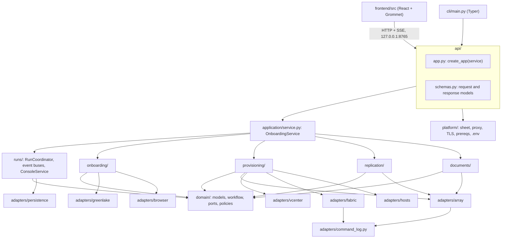
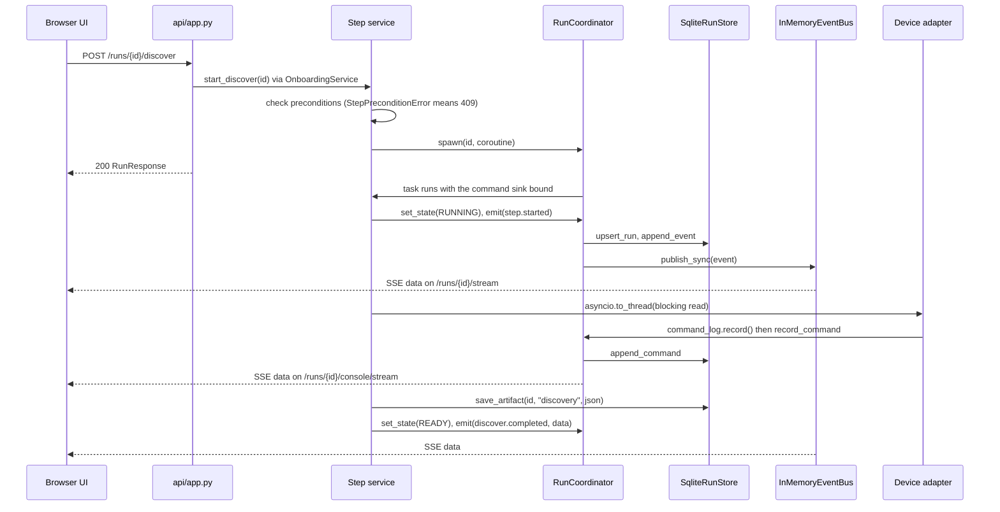

# Low-level design: alletra_onboard

**Version described:** 0.18.0 (`src/alletra_onboard/__init__.py`). **Audience:** a developer or a
reviewer who needs the module-level design: which module owns what, which outside call happens
where, and what is stored.

This document is written from the code. Where it and the code disagree, the code is right and this
document needs fixing. Related documents:

- [HLD.md](HLD.md): the high-level design (system context, control planes, deployment).
- [STANDARD.md](../STANDARD.md): the engineering standard and fitness rules enforced by the gate.
- [CONTEXT.md](../../CONTEXT.md): the domain words (run, array, fabric, VV set, removal set, ...).
- [AGENTS.md](../../../../AGENTS.md): the hard rules. This LLD shows where each rule is enforced.
- [docs/adr/](../adr/) and [docs/specs/](../specs/): why things are the way they are.

All paths below are relative to the app folder `Provisioning_Automation/alletra_onboard/` unless a
link says otherwise.

---

## 1. Layers

The code is ports and adapters. Dependencies point inward: `api` and `cli` call `application`;
`application` uses `domain` and builds `adapters` through factory functions; `domain` imports
nothing with I/O.



| Layer | Package | Owns | Must not |
|---|---|---|---|
| Domain | [`src/alletra_onboard/domain/`](../../src/alletra_onboard/domain/) | Pydantic models, enums, the step registry, port protocols, rate-limit and redaction policy | import an adapter or do I/O |
| Application | [`src/alletra_onboard/application/`](../../src/alletra_onboard/application/) | One package per bounded context (ADR 0011). Step services, plans, apply and verify logic | import FastAPI |
| Adapters | [`src/alletra_onboard/adapters/`](../../src/alletra_onboard/adapters/) | One package per outside system. Allowlists, protocol details, parsing of wire formats | call another adapter's system |
| API | [`src/alletra_onboard/api/`](../../src/alletra_onboard/api/) | HTTP routes, SSE streams, static UI serving, error-to-status mapping | hold step logic |
| CLI | [`src/alletra_onboard/cli/main.py`](../../src/alletra_onboard/cli/main.py) | `onboard ui`, `onboard api`, `onboard check` | |

Configuration is [`src/alletra_onboard/config.py`](../../src/alletra_onboard/config.py): `Settings` (pydantic-settings,
reads `.env`). Key fields: `api_host`/`api_port` (127.0.0.1:8765), `alletra_profile`
(`full` or `init-only`), `gl_client_id`, `gl_client_secret`, `gl_token_url`, `gl_base_url`
(`https://global.api.greenlake.hpe.com`), `state_database_path` (`.alletra_onboard/state.db`),
`artifact_dir`, `browser_cdp_url` (`http://localhost:9222`), `browser_proxy`,
`browser_proxy_bypass`, `alletra_proxy`, `alletra_device_ca_bundle` (ADR 0026, section 13.1).
`RunCoordinator.current_settings()` reloads settings at each
step, so credentials saved after start-up take effect without a restart.

---

## 2. Domain package

| Module | What it holds |
|---|---|
| [`models.py`](../../src/alletra_onboard/domain/models.py) | `WorkflowPhase` (every phase, including the six `GL_*` sub-phases), `RunMode`, `RunStatus`, `BrowserResultStatus`, `CheckStatus`. Intake: `ArrayWorkItem`, `NetworkConfig` (normalises a proxy URL to a bare host and port), `DsccSetupConfig`. Run state: `RunRecord`, `RunEvent`, `ExternalResources`. `ArrayCredential` (server side, holds the secret) and `ArrayCredentialInfo` (the shape that may leave the process, ADR 0013). Verify results: `FieldCheck`, `HealthIssue`, `HealthDetail`, `VerificationReport`. |
| [`workflow.py`](../../src/alletra_onboard/domain/workflow.py) | `StepDef`, `STEP_REGISTRY`, `_MODE_STEPS`, `REPLICATION_STEP_KEYS`, `mode_steps()`, `enabled_steps()`, `initial_phase()`, `next_enabled_phase()`. See section 4. |
| [`ports.py`](../../src/alletra_onboard/domain/ports.py) | The one protocol: `RunStore`. See section 3. |
| [`shared.py`](../../src/alletra_onboard/domain/shared.py) | `EndpointCreds` (host, username, `SecretStr` password), `Fabric` (`"odd"`/`"even"`), `normalize_wwpn`, `wwpn_colons`. |
| [`discovery.py`](../../src/alletra_onboard/domain/discovery.py) | `ArrayPort`, `EthernetPort`, `ArrayHost`, `HostHba`, `HostIdentity`, `HostRead`, `DiscoveredHost`, `DiscoveryReport`; OS guessing from an IQN, a switch string or a persona. |
| [`zoning.py`](../../src/alletra_onboard/domain/zoning.py) | Verify: `ExpectedZone`, `ZoneRemediation`, `ZoningReport`. Plan: `NsDevice`, `AliasedWwpn`, `FabricZonePlan`, `ZoningPlan`. |
| [`provisioning.py`](../../src/alletra_onboard/domain/provisioning.py) | The intent (`ProvisioningIntent` with `volumes`, `host_sets`, `exports`, `declared_hosts`, endpoint credentials and an optional `replication`), the builder palette (`ProvisioningObjects`, `ProvisioningBuilder`, `ProvisioningComposition`), the plan (`PlannedAction`, `ProvisioningPlan`), the result (`ActionOutcome`, `RemovalItem`, `ProvisioningResult`), array records (`ArrayHostRecord`, `ArrayVolumeRecord`, `VlunTemplate`) and path verification (`VolumePath`, `HostPathStatus`, `PathVerification`, `EsxiLun`). `persona_for_os()`. |
| [`replication.py`](../../src/alletra_onboard/domain/replication.py) | The Replication tab (`ReplicationIntent`, `ProtectionRequest`, `RcipPortRequest`, `pair_ports`), the array view (`ReplicationArrayView`, `RcipPort`, `RcTransport`, `RcTarget`, `RcLink`, `RcGroup`), the check and plan (`ReplicationReport`, `Partnership`, `ReplicationPlan`, `ReplicationAction`, `PlannedCall`), results (`ReplicationResult`, `ReplicationOutcome`), verify (`ReplicationVerification`), link check (`LinkCheck`, `LinkPair`, `LinkCheckResult`) and failover test (`FailoverRecord`, `FailoverSide`, `FailoverStepRecord`). Constants: `RTT_LIMIT_MS` (sync 10 ms, async 200 ms), `GROUP_NAME_MAX = 22`, the `zz_rc_test*` test object names, `DR_ACTION_FAILOVER = 7`, `DR_ACTION_RECOVER = 9`, `DR_ACTION_RESTORE = 10`. |
| [`cloudinit_url.py`](../../src/alletra_onboard/domain/cloudinit_url.py) | `normalize_cloudinit_url()` and `is_valid_cloudinit_url()`: the setup wizard URL must be link-local (`https://169.254.*` or an `fe80::` IPv6 address with a zone); the path defaults to `/cloudinit`. |
| [`policies.py`](../../src/alletra_onboard/domain/policies.py) | `redact()` (Bearer tokens, `client_secret`, `subscription_key`), `RateBudget`, `TokenBucket`. |

---

## 3. Ports and the adapters that implement them

The protocol in [`domain/ports.py`](../../src/alletra_onboard/domain/ports.py) is structural
(`typing.Protocol`); nothing subclasses it.

| Port | Implemented by | Notes |
|---|---|---|
| `RunStore` | `SqliteRunStore` in [`adapters/persistence/sqlite.py`](../../src/alletra_onboard/adapters/persistence/sqlite.py) | Runs, events, work items, intents, pending sheets, artifacts, commands. Section 7. |

The event bus and the two browser adapters have no protocol (`EventSink`, `CloudinitWizard` and
`DsccSetupWizard` were removed on 2026-11-19, BL-65: nothing was typed against them):
`InMemoryEventBus` in [`application/runs/event_bus.py`](../../src/alletra_onboard/application/runs/event_bus.py)
(`publish()` is async; the coordinator calls `publish_sync()`), `CloudinitWizardAdapter` in
[`adapters/browser/cloudinit_wizard.py`](../../src/alletra_onboard/adapters/browser/cloudinit_wizard.py)
(its `run()` adds a keyword-only `auto_submit`) and `DsccSetupAdapter` in
[`adapters/browser/dscc_setup.py`](../../src/alletra_onboard/adapters/browser/dscc_setup.py)
(attach-only over CDP). The step services build them through factories, like the device clients.

The device clients have no domain protocol. They are injected as **factory callables** instead, so a
test passes a fake factory:

- [`application/provisioning/clients.py`](../../src/alletra_onboard/application/provisioning/clients.py):
  `make_wsapi`, `make_wsapi_v3`, `make_array_cli`, `make_rc_cli`, `make_snap_cli`, `make_vcenter`,
  `make_brocade`, `make_linux_host`, `make_windows_host`. Each takes an `EndpointCreds` (the two
  write-scoped SSH factories also take the plan's objects) and returns a context-manager client.
- [`application/onboarding/clients.py`](../../src/alletra_onboard/application/onboarding/clients.py):
  `make_greenlake(settings)` returns `GreenLakeClients` (token provider, HTTP client, devices,
  subscriptions, service catalogue). This is also the slot for a future DSCC cloud client (ADR 0006).
  `default_cloudinit_factory` and `default_dscc_factory` build the two browser adapters.
  `default_provision_factory` is in
  [`application/onboarding/steps.py`](../../src/alletra_onboard/application/onboarding/steps.py).
  All three are passed into `OnboardingService` and overridable in tests.
- [`application/platform/clients.py`](../../src/alletra_onboard/application/platform/clients.py):
  the system adapters by name: `clock_status`, `sync_clock`, `launch_discovery_tool`, `probe_tcp`,
  `probe_via_proxy`.
- [`application/onboarding/greenlake_preflight.py`](../../src/alletra_onboard/application/onboarding/greenlake_preflight.py)
  declares its own small protocols (`TokenProvider`, `DeviceLookup`, `SubscriptionLookup`,
  `ServiceCatalogLookup`).

---

## 4. Step registry, modes and `/app/profile`

[`domain/workflow.py`](../../src/alletra_onboard/domain/workflow.py) is the only place a step list
exists (hard rule 5).

| Key | Label | Phase | Kind |
|---|---|---|---|
| `greenlake` | GreenLake registration | `PREFLIGHT` | init |
| `cloudinit` | Cloud Connectivity | `CLOUDINIT_CONNECT` | init |
| `dscc` | DSCC Setup | `DSCC_SETUP_SYSTEM` | init |
| `discover` | Discovery | `STORAGE_DISCOVER` | provision |
| `zoning` | SAN Zoning | `STORAGE_ZONING` | provision |
| `migrate` | Migration | `STORAGE_MIGRATE` | migrate (not built yet: served with `unavailable`) |
| `provision` | Provision storage | `STORAGE_PROVISION` | provision |
| `replicate` | Replication | `STORAGE_REPLICATE` | replicate |
| `failover_test` | Failover test | `STORAGE_FAILOVER_TEST` | replicate |
| `verify` | Verify configuration | `CONFIG_VERIFY` | verify |
| `asbuilt` | As-built document | `ASBUILT_DOCUMENT` | verify |

| Mode | Steps |
|---|---|
| `FULL_ONBOARDING` | greenlake, cloudinit, dscc, verify, asbuilt |
| `PROVISION_ONLY` | discover, zoning, provision, verify, asbuilt |
| `BOTH` | greenlake, cloudinit, dscc, discover, zoning, provision, verify, asbuilt |
| `REPLICATE` | discover, zoning, provision, replicate, failover_test, verify, asbuilt |
| `MIGRATE` | discover, zoning, migrate, verify, asbuilt |
| `VERIFY_ONLY` | verify, asbuilt |
| `CUSTOM` | exactly `RunRecord.selected_steps`, in registry order |

Functions:

- `enabled_steps(mode, selected)` returns the steps in registry order.
- `initial_phase(mode, selected)` is the phase a new run lands on (its first step).
- `next_enabled_phase(mode, selected, after_key)` advances only along the `init` chain
  (greenlake, cloudinit, dscc). Every other step is started by the operator.
- `NOT_BUILT_STEPS` names the registry steps whose work is not built yet, with the operator's
  sentence. `RunCoordinator.create_run` refuses a run that includes one, and the mode chooser greys
  out every mode that does. Today: `migrate` (BL-27 slice 1 has the tab and the registry entry only).

`GET /app/profile` ([`api/app.py`](../../src/alletra_onboard/api/app.py), `app_profile`) serves:
`profile`, `init_only`, `title` (from `Settings`), `steps` (key, label, kind, phase for each
`StepDef`, and `unavailable`: the sentence from `NOT_BUILT_STEPS` for a step whose work is not built
yet, else empty), `modes` (from `mode_steps()`), and `capabilities` (`wsapi_sdk`, `wsapi_sdk_error`: did
this build import `python-3parclient`). The frontend's
[`modes.ts`](../../frontend/src/modes.ts) keeps only presentation extras (subtitles, mode blurbs)
and the TypeScript types for the served data.

Two run-creation rules live in `RunCoordinator.create_run`:

- A `replicate`-kind step needs a provisioning intent with a Replication tab, or the call raises
  `ValueError` (422 from the API).
- The `provision` step with an empty Volumes tab is refused.

---

## 5. Run lifecycle, coordinator and events

### 5.1 The pieces

[`application/service.py`](../../src/alletra_onboard/application/service.py) `OnboardingService`
is the composition root. It builds one `RunCoordinator` and six services over it, then delegates
one method to one service:

| Attribute | Class | Module |
|---|---|---|
| `coordinator` | `RunCoordinator` | [`runs/coordinator.py`](../../src/alletra_onboard/application/runs/coordinator.py) |
| `onboarding` | `OnboardingSteps` | [`onboarding/steps.py`](../../src/alletra_onboard/application/onboarding/steps.py) |
| `discovery_zoning` | `DiscoveryZoningSteps` | [`provisioning/steps.py`](../../src/alletra_onboard/application/provisioning/steps.py) |
| `provisioning` | `ProvisioningSteps` | same module |
| `replication` | `ReplicationSteps` | [`replication/steps.py`](../../src/alletra_onboard/application/replication/steps.py) |
| `documents` | `DocumentSteps` | [`documents/steps.py`](../../src/alletra_onboard/application/documents/steps.py) |
| `console` | `ConsoleService` | [`runs/console.py`](../../src/alletra_onboard/application/runs/console.py) |

`RunCoordinator` owns:

- **Run creation.** `create_run`, `stash_pending_sheet` (saves the parsed sheet under a single-use
  `uuid4().hex` token), `create_run_from_pending` (pops the token, then `create_run`).
- **The run's array.** `array_host(run_id)` returns the Initialisation tab's management IP if set,
  else the Provisioning tab's array host. `array_credential(run_id)` returns the Provisioning tab's
  array admin if it has a password, else the DSCC system credential, else none (ADR 0013).
- **Background steps.** `spawn(run_id, coro)` refuses a second task for the same run
  (`RunBusyError`), copies the context, binds the run's command sink into it, and starts the task
  under `_guarded`. `_guarded` turns any exception into `RETRYABLE_FAILURE` plus a `step.crashed`
  event, so a run is never left in `RUNNING`.
- **State and events.** `set_state(run, status, phase)` updates and upserts the run.
  `emit(run_id, phase, event_type, message, data)` appends the event to the store and publishes it
  on the bus.
- **The command log.** `record_command`, `command_sink`, `recording()` and `list_commands`
  (section 13).
- Exceptions: `RunNotFoundError`, `RunBusyError`, `StepPreconditionError`,
  `PendingSheetNotFoundError`.

### 5.2 One step, start to finish



Blocking SDK and SSH calls run in `asyncio.to_thread`. A progress callback from a worker thread
reaches the loop with `loop.call_soon_threadsafe(coord.emit, ...)`.

### 5.3 Status and phase rules

`RunStatus` values: `not_started`, `ready`, `running`, `waiting_for_operator`, `retryable_failure`,
`terminal_failure`, `succeeded`. (`cancel_requested`, `cancelled` and `skipped` were removed in BL-56;
no release ever set them. A stored run that carries one still loads, as `ready`.)

| Step | Sets on start | On success | On failure |
|---|---|---|---|
| greenlake | `RUNNING`, `GL_DISCOVER_SERVICE`; the provider moves the phase through `GL_*` | `READY`, next init phase | `RETRYABLE_FAILURE` |
| cloudinit | `RUNNING`, `CLOUDINIT_CONNECT` | `READY`, next init phase; or `WAITING_FOR_OPERATOR` at the review screen | `RETRYABLE_FAILURE` or `TERMINAL_FAILURE` |
| dscc | `RUNNING`, `DSCC_SETUP_SYSTEM` | `WAITING_FOR_OPERATOR` (the operator adds the credential and submits) | as cloudinit |
| discover, zoning plan | `RUNNING`, the step's phase | `READY` | `RETRYABLE_FAILURE` |
| zoning verify | `RUNNING`, `STORAGE_ZONING` | `READY` when zoning is proper, else `WAITING_FOR_OPERATOR` | `RETRYABLE_FAILURE` |
| provision preview | `RUNNING` | `WAITING_FOR_OPERATOR` (plan shown) | `RETRYABLE_FAILURE` |
| provision apply | `RUNNING` | `READY` | `RETRYABLE_FAILURE` |
| path verify | `RUNNING`, `STORAGE_PROVISION` | `WAITING_FOR_OPERATOR` (report shown) | `RETRYABLE_FAILURE` |
| replication preview, link check | `RUNNING`, `STORAGE_REPLICATE` | `WAITING_FOR_OPERATOR` | `RETRYABLE_FAILURE` |
| replication apply, replication verify, failover test | `RUNNING`, the step's phase | `READY` | `RETRYABLE_FAILURE` |
| verify, asbuilt | **nothing** | **nothing**; events only | **nothing**; events only |

`POST /runs/{id}/complete` (`mark_complete`) sets `SUCCEEDED` and `COMPLETE` after the operator
finishes the DSCC wizard by hand.

### 5.4 Event types

Every event is a `RunEvent` (`event_id`, `run_id`, `phase`, `event_type`, `message`, `data`,
`created_at`). The UI renders from events, not from the POST response. The types emitted today:

| Family | Types |
|---|---|
| Run | `run.created`, `run.completed` |
| Generic step | `step.started`, `step.completed`, `step.failed`, `step.stalled`, `step.crashed`, `phase.progress` |
| Operator gates | `operator.review_ready` (cloudinit), `operator.credentials_ready` (DSCC) |
| Discovery and zoning | `discover.completed`, `zoning.previewed`, `zoning.proper`, `zoning.plan`, `zoning.rendered` |
| Provisioning | `storage.previewed`, `storage.preview.failed`, `storage.apply.started`, `storage.applied`, `storage.apply.failed`, `storage.paths.checking`, `storage.paths.verified`, `storage.paths.failed` |
| Replication | `replication.previewed`, `replication.preview.failed`, `replication.link_check.started`, `replication.link_checked`, `replication.link_check.failed`, `replication.apply.started`, `replication.applied`, `replication.apply.failed`, `replication.verify.started`, `replication.verified`, `replication.verify.failed`, `failover.started`, `failover.completed`, `failover.failed` |
| Documents | `verify.completed`, `verify.failed`, `asbuilt.started`, `asbuilt.generated`, `asbuilt.failed` |
| Device trust (section 13.1) | `device.trusted` (first contact; never decides a step), `device.trust_failed` (a device was refused during the step; the step shows stopped), `device.refused` (refused while a route read it, such as the console; a note), `device.retrusted` (the operator's re-trust, both fingerprints in `data`) |

The as-built step reads the latest payload of several of these back from the store
(`DocumentSteps._run_records`) to write the provisioning, zoning and replication sections.

### 5.5 SSE streams

Two streams, both in `api/app.py`, both `text/event-stream` with a `: heartbeat` comment every
`SSE_HEARTBEAT_S = 15` seconds:

| Stream | Source | Payload |
|---|---|---|
| `GET /runs/{id}/stream` | `InMemoryEventBus.subscribe(run_id)` | `RunEvent` JSON |
| `GET /runs/{id}/console/stream` | `ConsoleBus.subscribe(run_id)` on the coordinator | command record JSON |

The bus keeps no backlog for a new subscriber. The UI hook
[`useRunEvents.ts`](../../frontend/src/useRunEvents.ts) first fetches `GET /runs/{id}/events`, then
opens the stream, and drops duplicates by `event_id`. Command records are kept apart from run events
so a step's activity list never fills with commands.

---

## 6. HTTP routes

All routes are closures inside `create_app(service)` in
[`api/app.py`](../../src/alletra_onboard/api/app.py). Request and response models are in
[`api/schemas.py`](../../src/alletra_onboard/api/schemas.py). Step routes go through
`_start_step`, which maps errors to status codes (section 14).

| Method | Path | Purpose |
|---|---|---|
| GET | `/health` | Version. |
| GET | `/app/profile` | Build profile, title, step registry, modes, SDK capability (section 4). |
| GET | `/config` | GreenLake credentials from `.env`, masked. |
| POST | `/config` | Save GreenLake credentials to `.env`. |
| POST | `/config/check` | Token fetch plus provisioned services (`greenlake_check`). |
| GET | `/prereqs/firewall` | Firewall rules for a DSCC region (`region`, default `jp1`). |
| GET | `/prereqs/firewall.txt` | The same rules as a download. |
| GET | `/prereqs/connectivity` | TCP reachability to the HPE endpoints through the effective proxy. |
| GET | `/prereqs/proxy` | Detected, manual and effective proxy. |
| POST | `/prereqs/proxy` | Save a proxy override (or `direct://`) and re-publish it to the process. |
| GET | `/work-items/template` | CSV intake template (older intake path). |
| POST | `/work-items/parse` | Parse CSV text into work items (never echoes the DSCC password). |
| GET | `/init-sheet/template` | Blank `Initialisation_sheet.xlsx` (no provisioning tabs in `init-only`). |
| POST | `/init-sheet/compose` | Build a filled workbook from JSON (the session runner, SPEC-006). Holds nothing. |
| POST | `/init-sheet/upload` | Parse and validate a base64 workbook, save its GreenLake credentials, hold it under a token. Returns the token, the work item without passwords, the endpoint hosts and users, the RCIP rows and `problems`: one sentence for each problem in a tab initialising the array does not use (422 only for the Initialisation tab or two arrays). |
| POST | `/runs` | Create a run from a work item in the body (CSV path). |
| POST | `/runs/from-sheet` | Create the run from a held sheet token and a mode. 410 if the token is gone. 422 with the sentence when the upload listed a problem in a tab the chosen steps use (the hold stays). |
| GET | `/runs` | List runs, newest first. |
| GET | `/runs/{id}` | Run, work item and `ArrayCredentialInfo` (never the secret). |
| POST | `/runs/{id}/provision` | **GreenLake registration** (step `greenlake`; the name predates the storage steps). `dry_run` supported. |
| POST | `/runs/{id}/cloudinit` | Drive the array's Cloud Connectivity wizard. Takes a fresh `cloudinit_url`. |
| POST | `/runs/{id}/dscc` | Fill the DSCC Set Up System wizard over CDP. |
| POST | `/runs/{id}/verify` | Read-only config and health check over SSH. |
| POST | `/runs/{id}/asbuilt` | Read the array(s) and build the as-built `.docx`. |
| GET | `/runs/{id}/asbuilt/download` | The stored `.docx`. 404 until one exists. |
| POST | `/runs/{id}/complete` | Mark the run complete after DSCC finalise. |
| POST | `/runs/{id}/discover` | Discovery (array, vCenter, sheet hosts). |
| POST | `/runs/{id}/zoning/preview` | Zoning verify from the discovery report. |
| POST | `/runs/{id}/zoning/plan` | Read both switches and build the zoning plan. No switch writes. |
| POST | `/zoning/render` | Render the Brocade command set from a plan, aliases and selected pairs; with `run_id`, record it as `zoning.rendered`. |
| GET | `/runs/{id}/storage/preflight` | Read-only readiness over WSAPI and vCenter. |
| GET | `/runs/{id}/storage/objects` | The builder palette: array objects, planned objects, discovered hosts. |
| POST | `/runs/{id}/storage/builder` | Save the operator's host-set, VV-set and export composition onto the intent. |
| POST | `/runs/{id}/storage/preview` | Build the provisioning plan (the approval gate). |
| POST | `/runs/{id}/storage/apply` | Apply the previewed plan over WSAPI. |
| POST | `/runs/{id}/storage/verify-paths` | Path verification (`showvlun -a`, plus vCenter when present). |
| POST | `/runs/{id}/replication/preview` | Read both arrays, check, plan. |
| POST | `/runs/{id}/replication/link-check` | `checkrclink` on each RCIP pair (`duration_s` 300 to 172800). |
| POST | `/runs/{id}/replication/apply` | Apply the replication plan (partnership over SSH, or groups over WSAPI). `accept_latency` overrides the latency gate. |
| POST | `/runs/{id}/replication/verify` | `showrcopy` on both arrays, one verdict per group. |
| POST | `/runs/{id}/replication/failover-test` | Failover test on one group (`group`, `confirm`). |
| GET | `/runs/{id}/trust` | The devices the run trusts (fingerprints only) and the device CA bundle in use (section 13.1). |
| POST | `/runs/{id}/trust/retrust` | Trust the key a device presented when it was refused (`kind`, `host`, `port`, `fingerprint`). 404 for a device the run never reached; 409 when nothing was refused or the fingerprint is not the one refused. |
| GET | `/runs/{id}/events` | Event history from the store. |
| GET | `/runs/{id}/stream` | Event SSE stream. |
| GET | `/runs/{id}/console/log` | Command records after `since`; `format=txt` downloads them as text. |
| GET | `/runs/{id}/console/targets` | `array` and `peer` as `user@host`. |
| POST | `/runs/{id}/console` | Run one read-only command on the array or peer. Refusals return 200 with `refused: true`. |
| POST | `/runs/{id}/console/terminal` | Open a local terminal with `ssh user@host` (no password passed). |
| GET | `/runs/{id}/console/stream` | Command record SSE stream. |
| POST | `/browser/launch` | Start Chrome or Edge with `--remote-debugging-port` (default 9222). |
| POST | `/tools/discovery/launch` | Start the HPE Discovery Tool on the jump box. |
| GET | `/system/clock` | Compare the local clock with an HTTPS `Date` header, taking the local time at the midpoint of that one request (a slow source before it is not skew). |
| POST | `/system/clock/sync` | Set the Windows clock to the `Date` header plus half the round trip (403 when not elevated). |
| POST | `/preflight` | Local work-item checks, optionally live GreenLake reads. |
| (mount) | `/` | `frontend/dist` as static files when present (`sys._MEIPASS` first in a frozen build). |

Middleware: CORS for the Vite dev server on `:5173`; `Cache-Control: no-cache` on `/` and
`/index.html`, and a one-year immutable cache on `/assets/*`.

---

## 7. Persistence: SQLite schema

[`adapters/persistence/sqlite.py`](../../src/alletra_onboard/adapters/persistence/sqlite.py)
`SqliteRunStore`. `initialize()` creates the file, sets `journal_mode=WAL` and `busy_timeout=5000`,
brings the schema to the current version and purges expired pending sheets. Each call opens its own
connection. New fields go into the JSON `payload`, and Pydantic defaults load older rows.

**Schema version.** `MIGRATIONS` is an ordered list; entry N takes a database from version N-1 to N,
and the version is kept in `PRAGMA user_version`. `_migrate` runs the missing entries and sets the
version in one `BEGIN IMMEDIATE` transaction. Version 1 is the schema as it stood before versions
were recorded, all `CREATE TABLE IF NOT EXISTS`, so a database from then (`user_version` 0) becomes
version 1 with no other change. A database with a higher version than `SCHEMA_VERSION` is refused at
start-up with `StateDatabaseTooNewError` ("...saved by a newer version of this tool..."), and left as
it is. A schema change adds the next entry; a shipped entry is never edited.

| Table | Key | Columns | Holds |
|---|---|---|---|
| `runs` | `run_id` | `serial_number`, `status`, `current_phase`, `payload` (RunRecord JSON), `updated_at` | One row per run. |
| `run_events` | `event_id` | `run_id`, `phase`, `event_type`, `payload` (RunEvent JSON), `created_at` | Every event. |
| `work_items` | `run_id` | `payload` | `ArrayWorkItem` **with** the subscription key and DSCC password, encrypted. |
| `provisioning_intents` | `run_id` | `payload` | `ProvisioningIntent` **with** array, vCenter, switch, host, peer and migration source passwords, encrypted. |
| `pending_sheets` | `token` | `payload`, `created_at` | A parsed sheet waiting for a mode (its secrets and any held workbook encrypted); deleted on pop, purged after `PENDING_SHEET_TTL` (24 hours) on start-up and on each upload. |
| `run_artifacts` | (`run_id`, `kind`) | `payload` BLOB, `updated_at` | Durable step results. |
| `run_commands` | (`run_id`, `seq`) | `payload` | The command log (section 13). |
| `run_device_pins` | (`run_id`, `kind`, `host`, `port`) | `payload` (`DevicePin` JSON) | The key or certificate each on-site device presented on the run's first contact (section 13.1). A table of its own because steps write back whole `RunRecord`s read earlier. |

`_work_item_json` and `_provisioning_intent_json` produce the secrets in clear, because
`model_dump_json` would mask `SecretStr` and break the round trip. Before the row is written,
`_sealed` replaces each secret at the paths in `_WORK_ITEM_SECRETS` and `_INTENT_SECRETS` with
`{"fernet": "<token>"}`; `_opened` reverses it on read ([ADR 0027](../adr/0027-stored-credentials-encrypted-at-rest.md)).
The `SecretBox` in [`adapters/persistence/secrets.py`](../../src/alletra_onboard/adapters/persistence/secrets.py)
holds the Fernet key, read from `secrets.key` next to the database and made (0600 on POSIX) on the first
save. A plain string at a secret path is a row from before encryption and is read as it is; the next save
encrypts it. A sealed value that does not decrypt (no key file, or another installation's) raises
`StoredCredentialsUnreadableError` (`domain/ports.py`, message `CREDENTIALS_UNREADABLE`): the API answers
409 with the sentence, `GET /runs/{id}` still returns the run with `work_item` and `array_credential` empty,
and a background step records the sentence as its `step.crashed` event. The database and the key live in
the gitignored `.alletra_onboard/` folder, or under `%LOCALAPPDATA%\AlletraOnboard` in a frozen build
(`packaging/app_main.py`, `_place_state`).

Artifact kinds in use:

| Kind | Written by | Content |
|---|---|---|
| `discovery` | `DiscoveryZoningSteps` | `DiscoveryReport` JSON |
| `zoned_hosts` | `DiscoveryZoningSteps` | Host names, one per line (the per-host export gate) |
| `replication_report` | `ReplicationSteps` | `ReplicationReport` JSON |
| `link_check` | `ReplicationSteps` | `LinkCheck` JSON |
| `replication_result` | `ReplicationSteps` | `ReplicationResult` JSON |
| `failover_record` | `ReplicationSteps` | `FailoverRecord` JSON |
| `asbuilt_docx` | `DocumentSteps` | The `.docx` bytes |

Retention: `ARTIFACT_RETENTION_RUNS = 20`. Saving an artifact deletes artifacts of runs outside the
20 most recently updated. The first command of a run does the same for `run_commands`. Runs and
events are kept.

**Approvals are not stored.** The previewed provisioning plan (`ProvisioningSteps._plan`) and the
replication plan (`ReplicationSteps._plan`) are held in memory with the inputs they were built from.
A restart, a new discovery or a builder edit withdraws them; an apply spends the replication plan.
See [LESSONS.md](../LESSONS.md) lesson 6.

---

## 8. Array adapters

### 8.1 Read-only SSH: `ArrayCliClient`

[`adapters/array/cli_client.py`](../../src/alletra_onboard/adapters/array/cli_client.py), paramiko
through `device_trust.open_ssh` (a fresh array has no known host key: trusted on first contact and
pinned for the run, section 13.1), connect timeout 15 s, per-command cap 120 s.

`ALLOWED_COMMANDS` (the first word must be one of these):

| Group | Commands |
|---|---|
| Post-init verify | `showsys`, `shownet`, `showdate`, `showversion` |
| Health, inventory, as-built | `checkhealth`, `showinventory`, `showpd`, `shownode`, `showcage` |
| Provisioning and discovery | `showwsapi`, `showcpg`, `showspace`, `showvv`, `showvlun`, `showhost`, `showport`, `showportdev`, `showrcopy`, `showtarget`, `showhostset`, `showvvset` |
| Replication read | `showrctransport` |

`refusal(command)` rejects any of `; | & \` $ > <` and newlines, then any first word not on the list.
`run()` and the console prompt both use it.

**Diagnostic allowlist** (SPEC-020). `run_diagnostic(command, until=..., timeout=...)` accepts only
these whole-command shapes (`diagnostic_refusal`):

```
checkrclink startserver <N:S:P> <IPv4>
checkrclink stopserver <N:S:P>
checkrclink startclient <N:S:P> <IPv4> <time>      time 300..172800
checkrclink stopclient <N:S:P>
controlport rcip ping -c <count> <IPv4> <N:S:P>     count 1..20
```

With `until` (a regex) the output is streamed and the channel closed once the pattern appears.
Only [`replication/link_check.py`](../../src/alletra_onboard/application/replication/link_check.py)
calls it.

Commands the application sends through `run()`, by caller:

| Caller | Commands |
|---|---|
| `provisioning/discovery.py` | `showport -iscsi`, `showport`, `showport -rcip`, `showport -file`, `showhost -d`, `showportdev fcfabric <N:S:P>` |
| `provisioning/path_verify.py` | `showvlun -a` |
| `documents/verification.py` | `showsys -d`, `shownet`, `showdate`, `checkhealth -svc -detail`, `showversion`, `showsys`, `showcpg`, `showpd`, `showinventory` |
| `documents/steps.py` (as-built) | `shownode`, `showcage`, `showsys -d`, `shownet`, `showversion`, `showpd`, `showcpg`, `showport`, `showport -par`, `showinventory -csvtable`, `checkhealth -svc -detail`, then `showhost -d`, `showhostset`, `showvv`, `showvv -showcols Id,Name,Prov,Type,CPG,VSize_MB`, `showvvset`, `showvlun -t`, `showvlun -a` |
| `replication/read.py` | `showsys`, `showversion`, `showport`, `showport -rcip`, `showrctransport -rcip`, `showrcopy`, `showcpg`, `showvvset`, `showvv -showcols Name,VSize_MB` |
| `replication/verify.py`, `failover.py`, `partnership.py` | `showrcopy` and its `groups`, `targets`, `links` forms; `showport -rcip` |
| `runs/console.py` | Whatever the operator types, if `refusal()` allows it |

### 8.2 Write-scoped SSH: `ArrayRcCliClient` (ADR 0015)

[`adapters/array/rc_cli_client.py`](../../src/alletra_onboard/adapters/array/rc_cli_client.py)
subclasses `ArrayCliClient`. `run()` keeps the read allowlist; `write()` accepts only
`RC_WRITE_FORMS`, each a full-line regex:

| Name | Shape |
|---|---|
| `startrcopy` | `startrcopy` |
| `controlport rcip addr` | `controlport rcip addr -f <IPv4> <netmask or 1..32> <N:S:P>` |
| `controlport rcip gw` | `controlport rcip gw -f <IPv4> <N:S:P>` |
| `controlport rcip ping` | `controlport rcip ping [-c 1..10] <IPv4> <N:S:P>` |
| `creatercopytarget` | `creatercopytarget <target> IP <N:S:P:IPv4> [<N:S:P:IPv4> ...]` |
| `admitrcopylink` | `admitrcopylink <target> <N:S:P:IPv4> [...]` |
| `dismissrcopylink` | `dismissrcopylink <target> <N:S:P:IPv4> [...]` |
| `removercopytarget` | `removercopytarget <target>` (no `-cleargroups`) |

`rc_write_refusal` also checks every address is a valid IPv4, a prefix is 1 to 32, and a dotted mask
is contiguous. Every `write()` is logged with `write=True`. `answered_error()` treats any output line
starting with `Error` as a failure.

Only `make_rc_cli` builds this client, and only
[`replication/partnership.py`](../../src/alletra_onboard/application/replication/partnership.py)
`apply_partnership` calls that factory, inside the apply of an approved plan. Today it sends
`controlport rcip addr`, `controlport rcip gw`, `controlport rcip ping -c 3`, `startrcopy` and
`creatercopytarget`. The link and target removal forms are allowed but not sent by any code path.

### 8.3 WSAPI: `WsapiClient`

[`adapters/array/wsapi_client.py`](../../src/alletra_onboard/adapters/array/wsapi_client.py) wraps
`python-3parclient` (`HPE3ParClient`) against `https://<array>:443/api/v1`. Design points:

- **Certificate pinned** (section 13.1). `connect()` reads the certificate (`device_trust.check_tls`)
  and compares it with the run's pin before the SDK client exists. The SDK runs with `secure=False`
  and `_pin_calls` binds the pinned SHA-256 for each of its calls; `_PinnedRequests`, installed as
  `hpe3parclient.http.requests`, sends those through a session whose adapter sets urllib3's
  `assert_fingerprint`. `_translate` turns the SDK's `SSLCertFailed` into the sentence naming both
  fingerprints. With a device CA bundle the SDK gets its path as `secure` instead.

- **Readiness gate.** `connect()` logs in. A 503, "not ready" or a timeout becomes `WsapiNotReady`
  with the remedy in the message.
- **Proxy bypass.** `device_trust.bypass_proxy_for(host)` adds the array to `NO_PROXY`.
- **Command log.** `_record_calls` wraps the SDK's `http._time_request`, so every HTTP call is
  recorded with transport `wsapi`; the session key in a logout URL is masked.
- **Personas by name.** `_WSAPI_PERSONA` maps `VMware` to 8, `WindowsServer` to 11, `Generic-ALUA`
  to 2 (the WSAPI enum, not the CLI numbering).
- **Idempotent creates.** Each `ensure_*` reads first or catches the SDK's conflict, and returns
  `created`, `exists` or `updated`. `EXISTENT_PATH` (a WWN on another host) is not swallowed.
- **Subscription gate.** An array that has not finished GreenLake onboarding refuses creates; the
  error is translated to say so.
- **A volume too large.** `ensure_volume` turns the array's HTTP 400 code 28 (*client request contains
  value that is too large*, live for 1 PiB on rack13-ARCUS, 2026-11-16) into a sentence naming the size
  and the fix (BL-55).

SDK calls used for **writes**:

| Client method | SDK call | Used by |
|---|---|---|
| `ensure_host` | `createHost(name, FCWwns=..., optional={persona})`, `modifyHost` (add WWNs) | provisioning apply |
| `ensure_iscsi_host` | `createHost(name, iscsiNames=..., optional={persona})`, `modifyHost` | provisioning apply |
| `ensure_host_set` | `createHostSet`, `modifyHostSet` (add members) | provisioning apply |
| `ensure_volume` | `createVolume(name, cpg, size_mib, optional)` | provisioning apply, replication test volume |
| `ensure_volume_set` | `createVolumeSet`, `modifyVolumeSet` | provisioning apply, replication test set and peer set |
| `ensure_vlun` | `createVLUN(volume, hostname=..., auto=True)` or with an explicit `lun` | provisioning apply |
| `create_remote_copy_group` | `createRemoteCopyGroup(name, targets, optional)` | replication apply |
| `set_remote_copy_group` | `modifyRemoteCopyGroup` (sync period, policies, auto recover) | replication apply |
| `admit_remote_copy_volume` | `addVolumeToRemoteCopyGroup(..., optional={"volumeAutoCreation": True})` | replication apply |
| `start_remote_copy_group` | `startRemoteCopy` | replication apply, failover test |
| `stop_remote_copy_group` | `stopRemoteCopy` | failover test |
| `remote_copy_dr_action` | `recoverRemoteCopyGroupFromDisaster(name, action)` with 7, 9 or 10 | failover test |

Reads: `getStorageSystemInfo`, `getCPGs`, `getPorts`, `getHosts`, `getHostSets`, `getVolumes`,
`getVolumeSets`, `getVLUNs`, `getRemoteCopyGroups`, `getRemoteCopyGroup`. Parsers `parse_hosts`,
`parse_volumes`, `parse_sets`, `parse_vlun_templates` are pinned to `tests/fixtures/rack13_wsapi/`.

---

## 9. GreenLake adapter and Component A

### 9.1 HTTP, auth and rate limits

- [`auth.py`](../../src/alletra_onboard/adapters/greenlake/auth.py) `OAuthClientCredentials`:
  client-credentials grant, form-encoded, to `GL_TOKEN_URL`. The token is cached and refreshed 60 s
  before `expires_in` (default 900).
- [`http_client.py`](../../src/alletra_onboard/adapters/greenlake/http_client.py)
  `GreenLakeHttpClient.request(method, path, bucket=...)`: takes a token from the named bucket,
  adds the Bearer header, retries 429, 500, 502, 503 and 504 up to 4 times (honours `Retry-After`,
  capped at 30 s; otherwise exponential from 0.5 s to 16 s). Any answer outside 2xx then raises
  `GreenLakeHttpError` ([`domain/errors.py`](../../src/alletra_onboard/domain/errors.py)), a
  redirect included: a `Location` is only ever read from an accepted write. TLS uses
  `ssl_context()` in [`adapters/tls.py`](../../src/alletra_onboard/adapters/tls.py) (OS trust
  store plus certifi).
- `TokenBucket.acquire()` ([`domain/policies.py`](../../src/alletra_onboard/domain/policies.py))
  holds the lock only to refill and take a token; the sleep happens outside the lock.

| Bucket | Capacity per 60 s |
|---|---|
| `default` (any unlisted name) | 60 |
| `device_add` | 25 |
| `device_patch` | 20 |
| `device_read` | 60 |
| `device_async_poll` | 90 |
| `subscription_add` | 4 |
| `subscription_read` | 30 |
| `subscription_async_poll` | 30 |
| `service_catalog_read` | 60 |

### 9.2 Endpoints

| Client | Method and path | Bucket | Notes |
|---|---|---|---|
| `ServiceCatalogClient.per_region_service_managers` | GET `/service-catalog/v1/per-region-service-managers` | `service_catalog_read` | |
| `ServiceCatalogClient.service_manager_provisions` | GET `/service-catalog/v1/service-manager-provisions` | `service_catalog_read` | Fetched unfiltered; filtered in code by `provisionStatus == PROVISIONED` and region. The id is `serviceManager.id`. |
| `SubscriptionsClient.find_by_key` | GET `/subscriptions/v1/subscriptions?filter=key eq '<key>'` | `subscription_read` | |
| `SubscriptionsClient.add_subscription` | POST `/subscriptions/v1/subscriptions` body `{"subscriptions":[{"key":...}]}` | `subscription_add` | Returns `Location`. |
| `DevicesClient.find_by_serial` | GET `/devices/v1/devices?filter=serialNumber eq '<serial>'` | `device_read` | |
| `DevicesClient.get` | GET `/devices/v1/devices/{id}` | `device_read` | |
| `DevicesClient.add_storage_device` | POST `/devices/v2beta1/devices` body `{serialNumber, deviceType: "STORAGE", partNumber, tags}` | `device_add` | `dry-run=true` query for a dry run. Returns `Location`. |
| `DevicesClient.assign_application` | PATCH `/devices/v1/devices?id={id}` body `{"application":{"id":...},"region":...}` | `device_patch` | `application/merge-patch+json`. |
| `DevicesClient.apply_subscription` | PATCH `/devices/v1/devices?id={id}` body `{"subscription":[{"id":...}]}` | `device_patch` | Second PATCH. |

The assignment is **two PATCH calls**: application and region first, subscription second. One call
with both is rejected by GreenLake.

### 9.3 Async operations

`poll_async(location, bucket, max_wait_seconds=900, on_progress=..., settled=...)` GETs the
`Location` URL until `status` (or `state`) is terminal:

- Success: `SUCCEEDED`, `SUCCESS`, `OK`, `COMPLETE`, `COMPLETED`, `DONE`.
- Failure: `FAILED`, `FAILURE`, `ERROR`, `TIMEDOUT`, `TIMEOUT`, `PAUSED`, `CANCELLED`; raises
  `GreenLakeAsyncOperationError` with the per-device reasons from `result.failedDevices`.
- It honours `suggestedPollingIntervalSeconds` (clamped 1 to 30 s) and raises `TimeoutError` at the
  budget.
- `settled()` checks the real end state (for example, the serial is in inventory). When it is true,
  the poll stops with `SETTLED_BY_STATE`. This exists because a live operation once never reached a
  terminal status after the device was registered.

### 9.4 The registration flow

[`application/onboarding/greenlake_provision.py`](../../src/alletra_onboard/application/onboarding/greenlake_provision.py)
`GreenLakeProvisioningService.provision(item, dry_run)` runs six phases. Each phase reads first and
skips when the outcome already exists:

1. `GL_DISCOVER_SERVICE`: find a provisioned Data Services service manager in the region.
2. `GL_ADD_SUBSCRIPTION`: find by key, else add and poll (`settled` = key is queryable).
3. `GL_REGISTER_DEVICE`: find by serial, else add and poll (`settled` = serial in inventory).
4. `GL_ASSIGN_APPLICATION`: first PATCH, poll, then wait for `assignedState == ASSIGNED_TO_SERVICE`.
5. `GL_APPLY_SUBSCRIPTION`: second PATCH. A failure here is a warning, not a stop.
6. `GL_VERIFY_DEVICE`: assigned state and application id are required; a missing subscription is a
   warning.

Exception text passes through `domain.policies.redact()` before it reaches an event.
[`greenlake_preflight.py`](../../src/alletra_onboard/application/onboarding/greenlake_preflight.py)
runs the same reads as checks, and [`health.py`](../../src/alletra_onboard/application/onboarding/health.py)
`greenlake_check` backs `POST /config/check` and `onboard check`.
[`preflight_service.py`](../../src/alletra_onboard/application/onboarding/preflight_service.py)
checks the region pair: `ap-northeast` to `jp1`, `us-west` to `us1`, `eu-central` to `eu1`,
`eu-west` to `uk1`; an unknown pair is a warning.

Every GreenLake HTTP attempt, retries included, is written to the command log (transport
`greenlake`) as `METHOD /path`: no query, no body and no error text, because the subscription key
travels in the `find_by_key` filter and the add body, and httpx error text quotes the full URL. A 202's
`Location` path is the output. `POST`/`PATCH` are writes, except a device add with `dry-run=true`.
`OAuthClientCredentials` records the token request as `POST <token path> (client credentials
withheld)`, its answer as `(token withheld)`.

---

## 10. Browser adapter (Playwright)

[`adapters/browser/`](../../src/alletra_onboard/adapters/browser/):

| Module | Role |
|---|---|
| [`cloudinit_wizard.py`](../../src/alletra_onboard/adapters/browser/cloudinit_wizard.py) | `CloudinitWizardAdapter` (Component B). Launches its own Chromium (the installed Chrome or Edge channel when found) with `ignore_https_errors`, or attaches over CDP when a `cdp_url` is given. Waits up to `INIT_WAIT_S = 900` for a known screen, then drives Welcome, EULA, Network, Proxy, Time and Review. `_guarded_submit` checks the review values against the sheet. With `auto_submit` it submits and polls for the success text; otherwise it waits for the operator (`REVIEW_WAIT_S = 1800`). `fail-prov-*` text means GreenLake state, not network. |
| [`dscc_setup.py`](../../src/alletra_onboard/adapters/browser/dscc_setup.py) | `DsccSetupAdapter` (Component C). Attach only: `connect_over_cdp(cdp_url)` to the operator's signed-in browser. Fills Network and domain, Time, Proxy, Support contact and System inside the wizard iframe, then stops at the System credential and returns `WAITING_FOR_OPERATOR`. The operator chooses the credential and submits. It never closes the attached browser and never handles DSCC passwords or MFA. |
| [`debug_browser.py`](../../src/alletra_onboard/adapters/browser/debug_browser.py) | `launch_debug_browser()` starts Chrome or Edge with `--remote-debugging-port=<port>`, a separate profile, and an optional proxy with the bypass list. Returns `cdp_url = http://localhost:<port>`. |
| [`locators.py`](../../src/alletra_onboard/adapters/browser/locators.py) | `CLOUDINIT`, `CLOUDINIT_TEXT`, `DSCC`, `DSCC_TEXT`: every selector and every screen text in one file. |

Both wizard adapters add localhost to `NO_PROXY` so the CDP connection never goes through a proxy.
On a timeout or an unknown screen they save a screenshot and page text under `artifact_dir`.

---

## 11. Other device adapters

| Adapter | Transport | What it reads | Allowlist |
|---|---|---|---|
| [`vcenter/vcenter_client.py`](../../src/alletra_onboard/adapters/vcenter/vcenter_client.py) `VCenterClient` | pyVmomi `SmartConnect`, port 443; certificate probed and compared first, then `device_trust.pinned_context` on every connection (section 13.1) | `host_fc_hbas()` (ESXi FC HBA WWPNs and OS), `host_identities()` (FC and iSCSI identity, serial), `host_luns()` (`parse_storage_device`: LUNs, multipath state per path) | Read-only by construction: no method writes. |
| [`fabric/brocade_client.py`](../../src/alletra_onboard/adapters/fabric/brocade_client.py) `BrocadeClient` | paramiko SSH through `device_trust.open_ssh` | `cfgshow`, `alishow`, `nsshow`, `nscamshow`, `fabricshow`, `switchshow`, `cfgtransshow` | `ALLOWED_READ`: `cfgshow`, `zoneshow`, `alishow`, `nsshow`, `nscamshow`, `nsallshow`, `fabricshow`, `switchshow`, `cfgtransshow`. `_guard` refuses metacharacters and anything else (`BrocadeRefused`). There is no write method (ADR 0012). |
| [`hosts/linux_ssh.py`](../../src/alletra_onboard/adapters/hosts/linux_ssh.py) `LinuxHostClient` | paramiko SSH through `device_trust.open_ssh` | `read(key)` runs only `COMMANDS[key]`: `hostname`, `cat /etc/os-release`, `cat /sys/class/dmi/id/product_serial` (and `sudo -n` form), `cat /sys/class/fc_host/host*/port_name`, `cat /etc/iscsi/initiatorname.iscsi`, `multipath -ll` (and `sudo -n` form) | Fixed by key. |
| [`hosts/windows_winrm.py`](../../src/alletra_onboard/adapters/hosts/windows_winrm.py) `WindowsHostClient` | pywinrm, NTLM; `http://<host>:5985/wsman` first, then `https://<host>:5986/wsman`; proxy off; certificate not checked unless a device CA bundle is set (reason at the site) | `read(key)` runs only `SCRIPTS[key]`: `hostname`, `os` (Win32_OperatingSystem), `serial` (Win32_BIOS), `initiators` (`Get-InitiatorPort`), `mpio` (feature state, claimed 3PARdata hardware, 3PARdata disks). Each emits JSON. | Fixed by key. |
| [`system/clock.py`](../../src/alletra_onboard/adapters/system/clock.py) | HTTPS `Date` header | Clock skew; on Windows, sets the clock when elevated | |
| [`system/discovery_tool.py`](../../src/alletra_onboard/adapters/system/discovery_tool.py) | Local process | Finds and launches `*Discovery Tool*.exe` (the bundled copy, checked against its `.sha256` sidecar when one exists, then known folders) | |

Every adapter in this table except the clock and the Discovery Tool writes to the command log
(BL-54): `VCenterClient` one record for the login and one per inventory read (`vcenter`, output the
parsed rows), `LinuxHostClient.run` one per fixed command (`host-ssh`, `exit N`), `WindowsHostClient`
one per script, including the login probe on each listener (`winrm`).

---

## 12. Application contexts in detail

### 12.1 Provisioning (`application/provisioning/`)

| Module | Key functions | Notes |
|---|---|---|
| [`steps.py`](../../src/alletra_onboard/application/provisioning/steps.py) | `DiscoveryZoningSteps`: `start_discover`, `start_zoning_preview`, `start_zoning_plan`, `require_discovery`, `zoned_hosts`. `ProvisioningSteps`: `start_storage_preview`, `start_storage_apply`, `start_path_verify`, `get_storage_preflight`, `get_storage_objects`, `set_provisioning_builder`, `invalidate_plan` | Owns the discovery artifact and the in-memory plan gate. |
| [`discovery.py`](../../src/alletra_onboard/application/provisioning/discovery.py) | `discover()`, `parse_ports`, `parse_iscsi_ips`, `parse_replication_ports`, `parse_rcip_detail`, `parse_file_ports`, `parse_showhost`, `assemble_hosts`, `fabric_by_wwpn`, `resolve_port_fabrics` | One array SSH session, then vCenter, then the sheet's Hosts tab over SSH or WinRM. A failed source becomes a note. |
| [`zoning.py`](../../src/alletra_onboard/application/provisioning/zoning.py) | `build_report`, `summary`, `parse_active_zones`, `_remediations` | Verify from the discovery report only. Remediation is text. |
| [`zoning_plan.py`](../../src/alletra_onboard/application/provisioning/zoning_plan.py) | `build_zoning_plan`, `render_commands`, `alias_name_warnings`, parsers for `nsshow`, `alishow`, `cfgshow`, `switchshow`, `fabricshow`, `nscamshow`; FOS name rules | Reads both switches. `render_commands` builds the `alicreate`, `zonecreate`, `cfgadd`, `cfgenable` text the SAN team applies. |
| [`hosts.py`](../../src/alletra_onboard/application/provisioning/hosts.py) | `union_hosts`, `resolve_declared_hosts`, `declared_mismatches` | The host union in trust order: vCenter, Hosts tab, array hosts, fabric (SPEC-003). |
| [`preflight.py`](../../src/alletra_onboard/application/provisioning/preflight.py) | `run_preflight` | WSAPI reads (system, CPG free space, name collisions, FC ports) and a vCenter check. No writes. |
| [`storage_provision.py`](../../src/alletra_onboard/application/provisioning/storage_provision.py) | `build_plan`, `apply_plan`, `read_array_objects`, `host_briefs`, `removal_set`, `render_removal_commands` | Plan judges each object as create, exists, update or conflict. Apply order: hosts, host sets, volumes, VV sets, then exports judged against the VLUN templates read once, then a read-back. |
| [`path_verify.py`](../../src/alletra_onboard/application/provisioning/path_verify.py) | `verify_provisioned_paths`, `parse_showvlun_active`, `verify_paths`, `attach_esxi_view` | Per host: live, partial or no path. Reports only, never gates. |

The apply gate (`start_storage_apply`) refuses with `StepPreconditionError` when there is no
previewed plan, when discovery changed since the preview, when the plan has an error, or when it has
blockers. Exports to hosts the zoning step did not find reachable are held back and named in the plan.

### 12.2 Replication (`application/replication/`)

Direction is always this run's array (A, primary) to the peer (B). The peer's credentials come from
the Replication tab.

| Module | Role |
|---|---|
| [`read.py`](../../src/alletra_onboard/application/replication/read.py) | `read_array(creds)`: one read-only SSH session per array into a `ReplicationArrayView`. Parsers pinned to `tests/fixtures/rc_pair/`. |
| [`plan.py`](../../src/alletra_onboard/application/replication/plan.py) | `check()` (findings, partnership found by link addresses, not target names), `build_plan()` (exists, create or conflict per group, test objects, peer VV set). `GROUP_LIMIT` sync 800, async 2400. |
| [`partnership.py`](../../src/alletra_onboard/application/replication/partnership.py) | `plan_partnership()` from the Replication network tab; `apply_partnership()` over `ArrayRcCliClient` on both arrays: RCIP addresses and gateways, ping, `startrcopy`, `creatercopytarget`, then waits for links Up (180 s). |
| [`link_check.py`](../../src/alletra_onboard/application/replication/link_check.py) | `plan_pairs()`, `run_link_check()`: server on B, client on A, read until the latency, stop both; a ping fallback when no number is printed; re-reads links afterwards. |
| [`apply.py`](../../src/alletra_onboard/application/replication/apply.py) | `apply_plan()` over WSAPI on both arrays: test volume and set, then per group create, policies and period, admit each volume, peer VV set on B, start. Stops at the first failure. |
| [`verify.py`](../../src/alletra_onboard/application/replication/verify.py) | `verify()`: links Up, each planned group Started, roles right, volumes Synced. Names HPE's next step per state. |
| [`failover.py`](../../src/alletra_onboard/application/replication/failover.py) | `run_failover_test()`: stop, failover (7 on B), recover (9), wait for sync, restore (10), reading both arrays after every step. On an unexpected state it stops and records the way back as CLI text. |
| [`steps.py`](../../src/alletra_onboard/application/replication/steps.py) | `ReplicationSteps`: preview, link check, apply, verify, failover test. Holds the plan in memory. |

Gates in `ReplicationSteps`:

- **Apply** needs a previewed plan with no error, no blockers and at least one `create`. For an
  RCIP partnership it also needs a measured link check; over `RTT_LIMIT_MS` it needs
  `accept_latency`. The plan is popped after the apply.
- **Failover test** defaults to the tool's own test group. A group this run created may be chosen.
  Any other group needs its name typed back in `confirm`.

### 12.3 Documents (`application/documents/`)

| Module | Role |
|---|---|
| [`verification.py`](../../src/alletra_onboard/application/documents/verification.py) | `verify(item, user, pw)`: config reads compared with the work item (`FieldCheck` with match kind) and `checkhealth -svc -detail` parsed into `HealthIssue`s. |
| [`steps.py`](../../src/alletra_onboard/application/documents/steps.py) | `DocumentSteps`: `resolve_credential` (explicit pair, else the run's credential, else refuse), `start_verify`, `start_asbuilt`, `get_asbuilt`. Neither step changes run status; both catch every exception and emit a `*.failed` event. |
| [`asbuilt_parse.py`](../../src/alletra_onboard/application/documents/asbuilt_parse.py) | Splits the `===== $ <cmd> =====` dump into sections; parses key-value output, `checkhealth`, `showinventory -csvtable`, `showvv`, sets and `showvlun -t`. |
| [`asbuilt.py`](../../src/alletra_onboard/application/documents/asbuilt.py) | `AsBuiltData`; `generate_asbuilt()` fills `resources/asbuilt_template.docx`: placeholder fill, inventory and health tables, then the provisioned sections (hosts, volumes, presentations, zoning, provisioning record with the removal set), replication sections when the Replication tab exists, and a commands appendix. Returns bytes and warnings. |
| [`asbuilt_docx.py`](../../src/alletra_onboard/application/documents/asbuilt_docx.py) | `hpe_table()` and cell and border helpers in HPE house style. |

### 12.4 Onboarding and platform

`OnboardingSteps` (section 9.4, section 10) drives Components A, B and C. What sits in
`application/platform/` and what it may import is not listed here: the `B1-workflow-order` and
`L4-no-io-libraries` contracts in `pyproject.toml` and `L3-clients-only` in
`quality/imports-type-only.toml` say it, and `lint-imports` checks them.

---

## 13. Command log, console and redaction

[`adapters/command_log.py`](../../src/alletra_onboard/adapters/command_log.py) (SPEC-019):

- A `ContextVar` holds the current run's sink. `RunCoordinator.spawn` binds it into the step's
  copied context, so the task and every `asyncio.to_thread` it starts record to that run. Routes
  that read outside a step (`/storage/preflight`, `/storage/objects`, the console) use
  `coordinator.recording(run_id)`.
- `record(target, transport, command, started, ok, result, output, secrets, write)` builds one entry:
  `at`, `target`, `transport` (`ssh`, `wsapi`, `fos`, `vcenter`, `host-ssh`, `winrm`, `greenlake`),
  `command`, `duration_s`, `ok`, `result`
  (300 characters), `write`, `output` (capped at 64 KB). With no sink bound it does nothing.
  A failing sink never breaks the command.
- **Redaction.** Each client passes its own password in `secrets`; `redact()` replaces any secret of
  three characters or more with `********` in the command, result and output, then applies
  `domain.policies.redact()` (Bearer tokens, `client_secret`, subscription keys) to every record.
- The coordinator stores the entry (`append_command` returns the next `seq`) and pushes it on the
  `ConsoleBus`.

[`application/runs/console.py`](../../src/alletra_onboard/application/runs/console.py)
`ConsoleService`:

- `run(run_id, command, target)` collapses whitespace, checks `refusal()`, logs a refusal as a
  failed entry, otherwise runs the command over `ArrayCliClient` with the run's credential (or the
  peer's). It cannot reach a write path.
- `open_terminal` launches a local terminal with `ssh user@host` (Windows `cmd /k`, macOS Terminal,
  Linux `x-terminal-emulator` or `gnome-terminal`), after checking host and user against safe
  patterns. No password is passed.
- `console_text(entries)` is the `.txt` download format.

A second redaction, `domain.policies.redact()`, removes Bearer tokens, `client_secret` and
subscription keys from GreenLake error text.

### 13.1 Device trust (ADR 0026)

[`adapters/device_trust.py`](../../src/alletra_onboard/adapters/device_trust.py) is the one place every
SSH and TLS client to an on-site device asks:

- A `ContextVar` holds the run's `TrustBook`. `RunCoordinator.spawn` and `recording()` bind a
  [`RunTrustBook`](../../src/alletra_onboard/application/runs/trust.py) next to the command-log sink,
  so every client built in that step or route gets the run's pins. With none bound, nothing is
  compared or recorded.
- `check(kind, host, port, device, offered)` records the key on the run's first contact
  (`add_device_pin` is insert-if-absent, so two reads racing to the same device keep one), lets the
  same key through, and refuses a different one with `DeviceTrustError`, whose message
  (`domain/trust.py` `mismatch_message`) names the device and both fingerprints and says the password
  was not sent. Each client turns it into its own error type with the same text. A pin whose stored
  key does not decode (`key_readable`; only a damaged `state.db` holds one) is refused the same way,
  even when the fingerprints agree, with `unreadable_message`: the run's record of the key cannot be
  read, nothing was sent, and the re-trust steps (`RETRUST_STEPS`, shared with `mismatch_message`).
  `refusal_message` picks the sentence, for the error and for the run's events.
- SSH: `open_ssh(host, port, device=..., username=..., password=..., timeout=...)` preloads a pinned key
  (under `[host]:port` when the port is not 22) and sets `FirstContactPolicy`; paramiko compares the
  key before it authenticates. Keys are kept as type, base64 and `SHA256:` fingerprint. A pin that
  cannot be read is not preloaded: the policy meets the presented key and `check()` refuses it, so the
  pin records what was presented and the overview can trust it again.
- TLS: `probe_tls` reads the leaf certificate in a handshake that sends nothing (direct, never through
  the proxy); `check_tls` compares it. `tls_key` keeps the PEM and the SHA-256 as colon hex.
  `pinned_context` is an `ssl.SSLContext` that compares the certificate after every handshake made
  with it (for pyVmomi, whose `serverPemCert` cannot pin a self-signed vCenter).
- `device_ca_bundle()` returns `ALLETRA_DEVICE_CA_BUNDLE` (the run's setting, else the environment);
  set, WSAPI, vCenter and WinRM over HTTPS check against it instead, with no fallback.
- `RunTrustBook` emits `device.trusted` on first contact (from a worker thread, handed to the loop)
  and, when the step ends, one `device.trust_failed` per refused device in the step's phase. After a
  route (`recording()`), whose answer already carries the refusal, it emits `device.refused`, a note.
  `RunCoordinator.retrust_device` (`POST /runs/{id}/trust/retrust`) replaces the pin with the key
  the device presented when it was refused, only when the request names that fingerprint, and emits
  `device.retrusted`.
- Sites that still turn a check off carry a `# TRUST-OFF:` reason;
  `tests/unit/test_trust_checks_off.py` lists them and fails on a new one.

---

## 14. Error handling

### 14.1 API mapping

| Raised | Where | HTTP |
|---|---|---|
| `RunNotFoundError` | coordinator lookups | 404 |
| `RunBusyError` | `spawn` | 409 "a step is already running for this run" |
| `StepPreconditionError` | step `start_*` checks, console, storage reads | 409 with the operator sentence |
| `PendingSheetNotFoundError` | `/runs/from-sheet` | 410 |
| `ValueError` | `create_run` rules, sheet compose | 422 |
| Any parse error | `/init-sheet/upload`, `/work-items/parse` | 422 with the parser's message |
| `PermissionError` | `/system/clock/sync` | 403 |
| `RuntimeError` | `/browser/launch` | 500 |

### 14.2 Inside a step

- `_guarded` catches anything a step lets escape: `RETRYABLE_FAILURE` and `step.crashed` with the
  type and the first 300 characters.
- Step services catch their expected errors and emit a typed failure event with a sentence that says
  what to do. Verify and as-built catch everything, because they must never change run status.
- Adapter exceptions. Defined in [`domain/errors.py`](../../src/alletra_onboard/domain/errors.py),
  under one `DeviceError`: `ArrayCliError`, `WsapiError` and `WsapiNotReady`, `WsapiV3Error`,
  `WsapiV3TrustError` and `WsapiV3LoginRefused`, `GreenLakeHttpError` (any answer outside 2xx) and
  `GreenLakeAsyncOperationError`. Still defined in their adapters: `BrocadeError` and
  `BrocadeRefused`, `VCenterError`, `LinuxHostError`, `WindowsHostError`, `DsccSetupError`,
  `DeviceTrustError`. A poll that runs out of time raises `TimeoutError`.
  `WsapiClient._translate` turns SDK errors into sentences: not ready (503), wedged WSAPI (timeout,
  restart it with `stopwsapi` and `startwsapi`), subscription not finished. Every other refusal reads
  *Could not <what the tool was doing>. The array said: <the array's reason> (HTTP <status>, code <n>)*.
  The caller passes `where` in plain words (*create volume x*, *add 1 host(s) to host set y*), never an
  API call name, and no sentence says *WSAPI* (SPEC-030 R10; live 2026-11-17 the failed apply read
  *WSAPI createVolume zz_bl45_vol02+ failed: …*). Pinned by `test_no_array_error_names_an_api_call`.
- GreenLake: retryable status codes are retried in the HTTP client; a phase failure ends the
  pipeline with that phase recorded as failed.

### 14.3 Removal sets (undo text the tool never runs)

| Source | Function | Lines |
|---|---|---|
| Provisioning apply (SPEC-007) | `storage_provision.removal_set` | Only what this apply created, in paste order: `removevlun -f <vol> <lun> <target>` (from the template diff before and after), `removevvset -f`, `removevv -f`, `removehostset -f`, `removehost`. Objects that were `updated` are named in a note, not reverted. |
| Replication groups (SPEC-016 R7) | `replication.apply.apply_plan` | `removals_a` (groups, then the test set, then the test volume) and `removals_b` (peer sets, then the auto-created secondaries). |
| Partnership (SPEC-021) | `replication.partnership.apply_partnership` | Per side: `removercopytarget <target>`, `stoprcopy -f` (with `-stopgroups -clear` if Remote Copy was started by this run), `controlport rcip delete -f <N:S:P>` for each port this run addressed. |
| Failover test (SPEC-017) | `replication.failover.recovery_action` | HPE's documented way back for the observed roles. |

All of these are shown in the UI and written to the as-built. No code path sends them.

---

## 15. The initialisation sheet

[`application/platform/init_sheet.py`](../../src/alletra_onboard/application/platform/init_sheet.py).
One workbook is one array.

| Tab | Shape | Content |
|---|---|---|
| `Initialisation` | Field and Value rows | Sections: HPE GreenLake API access; Array (cloud enablement); Network; DSCC Setup (Support Contact, System, System Credentials); As-built document. |
| `Provisioning` | Field and Value rows | Array, vCenter and the two fabric switches (odd F1, even F2) with credentials; default CPG and provisioning type. |
| `Volumes` | Table | Name, size (GiB), type (`tpvv` or `reduce`), CPG, optional VV set. |
| `Hosts` | Table | Name, OS (`esxi`, `windows`, `linux`, `vme`), address, WWPNs, IQN, optional read-only login (optional tab). |
| `Host sets` | Table | Name and members (blank members are chosen in the app). |
| `Replication` | Field and Value rows plus a protection table | Peer array credentials, measured round-trip time, failover test choice; one row per VV set to protect (mode, RPO, peer CPG, peer VV set, auto synchronize, auto recover). |
| `Replication network` | Table | RCIP ports on both arrays: array (this or peer), port (N:S:P), address, netmask, optional gateway. |
| `Prerequisites` | Reference | Firewall rules and a checklist; the parser ignores it. |

`build_template_bytes(init_only)` leaves out the provisioning and replication tabs for the
`init-only` build. `compose_workbook_bytes()` fills a workbook from JSON for the session runner.

`parse_workbook_bytes(data, mode=..., selected_steps=..., complete=...)` returns `ParsedInitSheet`
(GreenLake credentials, `ArrayWorkItem`, optional `ProvisioningIntent`). The upload path uses
`parse_upload(data)` (owner, 2026-11-19): `complete=True` first, which validates the full superset and
always parses the provisioning tabs; when that raises, the Initialisation tab is parsed as a Full
onboarding run reads it (a problem there still raises, so does `_reject_two_arrays`) and every other tab
on its own. Each problem is one sentence in the returned list, the sentence the complete parse raises; a
bad Volumes or Hosts row is left out of the intent, a tab with a problem is left out whole. The hold then
keeps the file (`save_pending_sheet(..., workbook)`), and `create_run_from_pending` parses it again with
the chosen mode before it uses the hold up: a step that uses a tab with a problem refuses the run with
that sentence. Validation:

- The **Field** column is the key (`_LABEL_TO_KEY`); labels must not be renamed. Credential fields
  are kept verbatim; others are trimmed.
- Required keys come from `all_required_keys()` or `required_keys_for(mode, selected)`.
- `_reject_two_arrays`: the Initialisation IP and the Provisioning array IP must match when both are
  given (hard rule 4).
- `_reject_peer_is_this_array`: the peer cannot be this run's array.
- The Replication tab refuses the types in `_UNSUPPORTED_REPLICATION_TYPES` (peer persistence, active
  sync, SLD, 3DC, streaming, app); the network tab checks IPv4 addresses and masks, and pairs ports with `pair_ports`.
- A replication step selected without a Replication tab is refused.
- A volume size must be a whole number of GiB above 0, and not above `VOLUME_MAX_GIB`
  (`domain/provisioning.py`, BL-55): 65536 GiB, the 64 TiB the array's own `help createvv` states
  for thin and reduced volumes (rack13-ARCUS, OS 10.6.0, captured 2026-11-17). The plan applies the same check (`_judge_volume`: a new volume over the limit is a conflict,
  so a blocker), for intents that did not come through the sheet.
- A volume name must be at most `VOLUME_NAME_MAX` (255) characters of letters, digits, `.`, `-` and
  `_` (`volume_name_problem`, `domain/provisioning.py`), the rule the array's own `help createvv`
  states (rack13-ARCUS, OS 10.6.0, captured 2026-11-17). Refused on the sheet with one sentence
  (*Volume 'x+' — Name: the array takes only letters, digits, '.', '-' and '_' in a volume name, not
  '+'. Rename it.*); in the plan a new volume with such a name is a conflict, so a blocker. Live on
  2026-11-17 the array refused `zz_bl45_vol02+` only at apply (HTTP 400 code 69), after three other
  objects were made.
- A volume set name (the Volumes tab's *VV-set* column) must be letters, digits, `.`, `-` and `_`
  (`volume_set_name_problem`; BL-60): *Volume 'x' — VV-set: the array takes only letters, digits, '.',
  '-' and '_' in a volume set name, not '+'. Rename it.* The plan blocks a new set with such a name the
  same way (*… Rename it on the sheet's Volumes tab.*), for a set composed on the page. No `help
  createvvset` is captured; the rule is the array's own answer: on 2026-11-17 it refused
  `zz_bl45_vvs+` with code 69, as it refused the volume name. Its length is not checked until that help
  is captured (`help createsv`'s *up to 255* is about its own argument).
- A host name must be at most `HOST_NAME_MAX` (31) characters (`host_name_problem`; BL-60), the
  only rule `help createhost` states (D22U27, OS 10.5.0, captured 2026-10-26). Checked in the plan
  only, on a host the plan would create: a name on the Hosts tab may be a lookup that discovery
  resolves to the name vCenter or the array uses. A sheet host reads *the array takes at most 31
  characters in a host name, this one has 34. Give it a shorter name on the sheet's Hosts tab.*; a
  host named by vCenter, the array or the fabric says to leave it out of the host set. A host name's
  characters wait for a captured help that states them; host set names are not checked (no captured
  help).

On upload, the API saves the sheet's GreenLake credentials to `.env`, stashes the parsed sheet under a
token, and returns the work item without the DSCC password and the problems found in tabs a Full
onboarding run does not use. Device passwords never return to the browser.

---

## 16. Packaging and profiles

| Piece | File | What it does |
|---|---|---|
| PyInstaller spec | [`alletra_onboard.spec`](../../alletra_onboard.spec) | One-folder build named `AlletraOnboard`. Bundles Playwright's driver, `frontend/dist`, `tools/discovery`, `src/alletra_onboard/resources` (the as-built template) and the MSVC runtime DLLs. Hidden imports: uvicorn, the whole package, paramiko, winrm and its NTLM stack, `hpe3parclient`, eventlet, dns, requests. Writes `ALLETRA_BUILD_PROFILE` into `build_profile.txt`. |
| Frozen entry point | [`packaging/app_main.py`](../../packaging/app_main.py) | `_apply_build_profile` exports `ALLETRA_PROFILE` from the marker before settings load. `_place_state` moves the store to `%LOCALAPPDATA%\AlletraOnboard` unless one exists beside the exe. `ensure_chromium`, `selftest`, then uvicorn and the browser. |
| Playwright hook | [`packaging/rthook_playwright.py`](../../packaging/rthook_playwright.py) | Runtime hook for the bundled browser path. |
| Build script | [`scripts/build_exe.ps1`](../../scripts/build_exe.ps1) | `-Profile full` or `init-only`; output stem `alletra-onboard` or `alletra-mp-initialization`. |
| Release scripts | `scripts/build_release.ps1`, `scripts/publish_release.ps1` | Packaging and publishing (owner only). |

Profiles: `full` shows every mode; `init-only` (ADR 0007) serves `init_only: true` from
`/app/profile`, offers only the initialisation mode, ships a sheet without provisioning tabs and
parses uploads with `FULL_ONBOARDING` validation only. Shipped `.ps1` files must be pure ASCII.

`GET /app/profile` reports `capabilities.wsapi_sdk`, so a build that failed to bundle
`python-3parclient` is visible without touching an array. eventlet is bundled because the SDK
imports it; the code never monkey-patches with eventlet.

Two things are process-wide on purpose:

- **The SDK's `requests`.** On import, `adapters/array/wsapi_client.py` replaces the `requests`
  module attribute of `hpe3parclient.http` with `_PinnedRequests`, once. It passes everything through,
  and for a client bound to a pinned certificate (`_pin_calls`, a context variable per call) it sends
  each request through a session whose adapter checks the certificate's fingerprint, so the pinned
  certificate is checked on every WSAPI call (ADR 0026). Without a pin a call goes through unchanged.
- **The process environment.** Five places write the proxy variables:
  - `apply_proxy_env` (`application/platform/proxy.py`), at startup (`create_app`) and when the
    operator saves a proxy: sets or clears `HTTPS_PROXY`, `https_proxy`, `HTTP_PROXY`, `http_proxy`,
    and sets `NO_PROXY` / `no_proxy` (colon-free entries only).
  - `POST /prereqs/proxy` (`api/app.py`): sets `ALLETRA_PROXY` (and saves it to `.env`), then calls
    `apply_proxy_env`.
  - `bypass_proxy_for` (`adapters/device_trust.py`), called by the WSAPI client and the
    WSAPI v3 client (`wsapi_v3_client.py`) before they connect: adds the array's address to
    `NO_PROXY` / `no_proxy`.
  - `_ensure_localhost_no_proxy` in `adapters/browser/cloudinit_wizard.py` and
    `adapters/browser/dscc_setup.py`, before they attach over CDP: adds `localhost` and
    `127.0.0.1` to `NO_PROXY` / `no_proxy`.

  The packaged `.exe` also sets defaults before the app starts, never the proxy:
  `packaging/app_main.py` (`STATE_DATABASE_PATH`, `ARTIFACT_DIR`, `ALLETRA_PROFILE`) and
  `packaging/rthook_playwright.py` (`PLAYWRIGHT_BROWSERS_PATH`), each with `setdefault`.

---

## 17. Test strategy and fixtures

Hard rule 9: no live call in the suite. Tests use fakes injected through the factories in section 3,
and parsers are pinned to captured output.

| Folder | Kind |
|---|---|
| [`tests/unit/`](../../tests/unit/) | One file per area: API (`test_api.py`, FastAPI `TestClient` over a service with a temporary SQLite store), workflow, init sheet, discovery and zoning, provisioning plan and apply (`test_plan_truth.py`, `test_removal_set.py`, `test_provisioning_hosts.py`, `test_iscsi_hosts.py`), path verify, replication (`test_replication_*`, `test_rc_cli_client.py`), console, as-built, verify, proxy, TLS, clock, browser helpers, session runner. |
| [`tests/contract/`](../../tests/contract/) | GreenLake payload shapes, auth, read clients, `poll_async`, service catalogue, provisioning flow. They import the payload helpers without `httpx` (the adapters import the HTTP client under `TYPE_CHECKING`). |
| [`tests/fixtures/`](../../tests/fixtures/) | Scrubbed captures from lab hardware, each folder with a README saying where and when. |
| [`tests/conftest.py`](../../tests/conftest.py) | Turns off `.env` loading and clears `GL_*` variables for every test. |

| Fixture folder | Captured from | Pins |
|---|---|---|
| `rack13_array/` | Array CLI | `showhost -d`, `showvv`, `showvvset`, `showhostset`, `showvlun -a`/`-t`, `showcpg` |
| `rack13_wsapi/` | WSAPI JSON | hosts, host sets, volumes, volume sets, VLUNs |
| `rack13_fabric/`, `vz_fabric/` | Brocade FOS, both fabrics | `nsshow`, `nscamshow`, `alishow`, `cfgshow`, `fabricshow`, `switchshow` |
| `d22u27_iscsi/` | Array CLI and WSAPI | iSCSI ports and hosts, personas, `help createhost` |
| `rc_pair/` | Two arrays, Remote Copy | `showrcopy`, `showport -rcip`, `showrctransport`, group JSON, after-apply states |
| `rcip_pair/` | Two arrays, RCIP setup | `help` pages for the write forms, `checkrclink` outputs, the manual setup log |

The gate is [`scripts/check.py`](../../scripts/check.py): pytest, ruff, `npm run typecheck`, no
`frontend/dist` change, no token or lab password in added lines, and a warning for ignored files
under `src`, `tests` or `frontend/src`. Live proof is a separate thing: the scripts in
[`lab/`](../../lab/) run on the jump box only when the owner asks.

---

## 18. Frontend, briefly

[`frontend/src/`](../../frontend/src/): `App.tsx` (shell and step switch), `api.ts` (fetch client
and types), `useRunEvents.ts` (history plus SSE), `modes.ts` (types for the served registry),
`steps/` (one component per step), `ui/` (`StepShell`, `useStepState`, `ConsolePane`, status and
blocks). Step lists come from `/app/profile`. Step state comes from `useStepState` and the run's
events. Every write action has a confirmation tick before its button works. See
[UX-GUIDELINES.md](../UX-GUIDELINES.md).
